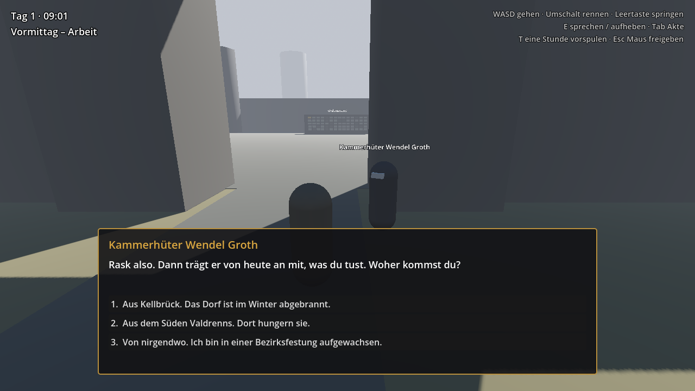

# Sorrowland: In Silentio

> *In silentio vigilamus. Aber wenn die Stille endet, handeln wir.*

Ein Open-World-Rollenspiel im Sorrowland des Jahres 1750: Du trittst als Vertriebener an die Schwelle des Ordo Custodum und steigst vom Anwärter zum Wächter auf, während die 620 Jahre alte Stille zu zerbrechen droht.

- Lore: [`docs/01-lore-bibel.md`](docs/01-lore-bibel.md)
- Spielkonzept und Fahrplan: [`docs/02-spielkonzept.md`](docs/02-spielkonzept.md)
- Karten: [`docs/bilder/`](docs/bilder/)



## Stand: Prototyp 1 – „Die Schwelle“

Ein Hof der Burgfeste Drachenstein als Graybox (Platzhalter aus einfachen Formen) mit:

- **Spielfigur** in Third Person mit Kamera, Laufen, Rennen und Springen
- **Tageszyklus** nach dem Alltag des Ordens: Morgengrauen, Arbeit, Mahl, Übung, **Stille-Stunde** (19–20 Uhr), Nachtwache. Ein Spieltag dauert 40 Minuten.
- **Gespräche** mit Antworten, die Flags, Akte, Rang und Zähler verändern
- **Vorgespräch und Gelöbnis** beim Kammerhüter → Rang Anwärter
- **Erste Arbeit:** drei Bruchsteine aus dem Bauhof zu Hüterin Maren Sell
- **Fenn**, der nach Fluchtgängen fragt. Meldest du ihn beim Kammerhüter?
- **Stille-Stunde:** Wer spricht, wird zuerst ermahnt, dann bekommt er einen Verweis in der Dienstakte
- **Ordenswand** mit Namenssteinen. Der goldene Stein oben links gehört Jorin, dem ersten Wächter.

## Starten

1. **Godot 4.7** (oder neuer) herunterladen: <https://godotengine.org/download>
   Die **Standardversion** nehmen, nicht die .NET-Version. Godot muss nicht installiert werden, die Datei einfach entpacken und starten.
2. Im Projektmanager auf **Importieren** klicken und die Datei `project.godot` aus diesem Ordner wählen.
3. Im Editor oben rechts auf **▶ (Projekt starten)** klicken oder **F5** drücken.

## Steuerung

| Taste | Aktion |
|---|---|
| W A S D | gehen |
| Umschalt | rennen |
| Leertaste | springen |
| Maus | Kamera |
| E | sprechen, aufheben, im Gespräch weiter |
| 1–9 | Antwort wählen (oder mit der Maus klicken) |
| Tab | Dienstakte ein/aus |
| T | eine Stunde vorspulen (zum Testen) |
| Esc | Maus freigeben, Klick fängt sie wieder ein |

## Projektaufbau

```
project.godot            Projekteinstellungen, Tastenbelegung, Autoloads
autoload/                immer geladene Spielsysteme
  spielzeit.gd           Uhrzeit, Tagesabschnitte, Stille-Stunde
  spielstand.gd          Rang, Dienstakte, Flags, Zähler, Bedingungen
  dialog.gd              liest und führt die Gespräche aus daten/dialoge/
szenen/
  welt/hof.tscn          Hauptszene: der Hof (startet mit F5)
  welt/tageslicht.gd     Sonnenstand und Helligkeit nach Uhrzeit
  welt/ordenswand.gd     setzt die Namenssteine
  spieler/               Spielfigur und Kamera
  figuren/person.tscn    ansprechbare Person (Name, Dialog, Kordel, Tracht)
  figuren/bruchstein.tscn  Gegenstand zum Aufheben
  oberflaeche/hud.tscn   Anzeige: Uhr, Hinweise, Gesprächsfenster, Akte
daten/dialoge/           Gespräche als JSON-Dateien
docs/                    Lore-Bibel, Spielkonzept, Karten, Bilder (von Godot ignoriert)
```

## Eine neue Person hinzufügen

1. `szenen/welt/hof.tscn` öffnen.
2. `szenen/figuren/person.tscn` aus dem Dateisystem-Dock in die Szene unter **Personen** ziehen.
3. Im Inspektor ausfüllen: **Anzeige Name**, **Dialog Id** (Dateiname ohne `.json`), **Kordel** (Rang), **Tracht** (Farbe).
4. Eine Datei `daten/dialoge/<dialog_id>.json` anlegen (siehe unten).

## Dialoge schreiben

Jede Datei hat Knoten. Begonnen wird beim Knoten `start`, außer ein Eintrag in `einstieg` passt. Diese werden von oben nach unten geprüft, der erste passende gewinnt.

```json
{
	"einstieg": [
		{ "bedingung": "geloebnis", "knoten": "danach" }
	],
	"knoten": {
		"start": {
			"text": "Was die Person sagt.",
			"optionen": [
				{ "text": "Antwort 1", "weiter": "zweiter_knoten" },
				{ "text": "Antwort 2", "bedingung": "fenn_fragte,!fenn_gemeldet", "setze": ["neues_flag"] }
			]
		},
		"zweiter_knoten": {
			"text": "Ohne Optionen geht es mit E weiter oder das Gespräch endet.",
			"weiter": "danach"
		},
		"danach": { "text": "Wach gut." }
	}
}
```

**Felder in Knoten und Antworten:**

| Feld | Wirkung |
|---|---|
| `text` | gesprochener Text (nur Knoten und Antworten) |
| `sprecher` | anderer Sprechername als die Person (nur Knoten) |
| `weiter` | nächster Knoten. Fehlt er, endet das Gespräch |
| `bedingung` | nur bei Antworten und Einstiegen: wann sie sichtbar oder gültig sind |
| `setze` | Liste von Flags, die gesetzt werden |
| `akte` | Eintrag in die Dienstakte |
| `zaehler` | Zähler ändern, z. B. `{ "bruchsteine": -3 }` |
| `rang` | Rang setzen (0 Bewerber, 1 Anwärter, 2 Knappe, 3 Geselle, 4 Wächter …) |
| `meldung` | kurze Einblendung oben im Bild |

**Bedingungen:** `flag` (gesetzt), `!flag` (nicht gesetzt), `zaehler>=3`. Mehrere werden durch Komma getrennt und müssen alle gelten.

## Nächste Schritte

Siehe Fahrplan in [`docs/02-spielkonzept.md`](docs/02-spielkonzept.md), Abschnitt 8. Als Nächstes kämen Akt I zu Ende (Küche, Knappenprüfung, Nachtwache, Eid und der eigene Namensstein auf der Ordenswand) und Speichern und Laden.
