# Sorrowland: In Silentio

> *In silentio vigilamus. Aber wenn die Stille endet, handeln wir.*

Ein Open-World-Rollenspiel im Sorrowland des Jahres 1750: Du trittst als Vertriebener an die Schwelle des Ordo Custodum und steigst vom Anwärter zum Wächter auf, während die 620 Jahre alte Stille zu zerbrechen droht.

- Lore: [`docs/01-lore-bibel.md`](docs/01-lore-bibel.md)
- Spielkonzept und Fahrplan: [`docs/02-spielkonzept.md`](docs/02-spielkonzept.md)
- Karten: [`docs/bilder/`](docs/bilder/)

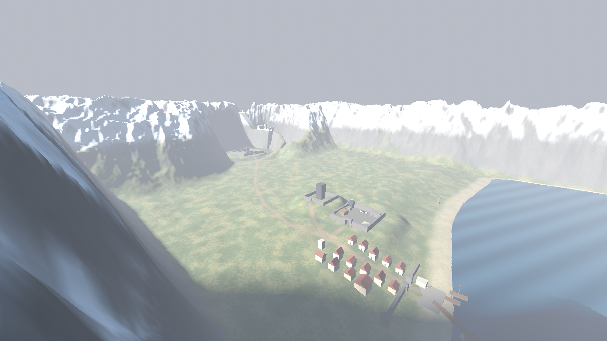

## Stand

### Grafik: echte Steine, echte Burgen

Weg vom Klötzchen-Look, Richtung Valheim:

- **Fotogescannte Texturen** statt selbst erzeugter: Mauern, Bruchstein, Basalt, Putz, Holz, Ziegel und Schiefer, Pflaster, Fels, Gras, Erde, Sand, Schnee und Sumpf. Alle sind CC0 (frei nutzbar) von [Poly Haven](https://polyhaven.com) und [ambientCG](https://ambientcg.com). `werkzeuge/texturen_laden.py` lädt sie, `texturen/groessen.json` nennt Quelle, Autoren und echte Größe.
- **Stein-Shader** (`szenen/welt/stein.gdshader`) für alle Steinmaterialien: keine sichtbare Wiederholung (zwei Maßstäbe, großflächige Farbschwankung), Moos und Flechten auf Mauerkronen, Zinnen und Gesimsen. Dazu Parallax aus den Höhenkarten (`texturen/<name>_hoehe.jpg`, Poly Haven, `texturen_laden.py --hoehen`): Fugen und Steinkanten liegen bis etwa 28 m Entfernung sichtbar zurück, tiefe Stellen sind dunkler (Fugenschatten). Verwitterung: Regenspuren auf senkrechten Flächen und Feuchte, Schmutz und Algen am Fuß jeder Wand über dem Gelände (die Geländehöhe liegt als globale Shader-Textur `gelaende_hoehe` vor, gesetzt von `gelaende.gd`). Dächer der Burg und alle Stadthäuser (Mauerwerk, Ziegel, Schiefer, Fachwerkbalken, Putz) bekommen ebenfalls Parallax-Tiefe.
- **Burg-Baukasten** (`szenen/welt/burgbau.gd`): Mauern, Türme und Tore sind keine Quader mehr, sondern echte Geometrie:
  - Mauern mit schrägem Anlauf am Fuß und hellem Sockelband, Gesims, Wehrgang mit Plattenbelag, Brustwehr mit Abdeckplatten und Zinnen. Jede Zinne hat eine vorstehende Abdeckplatte, eine leicht eigene Höhe, auf der Feldseite eine Kreuzscharte mit Rundloch und Gewände, auf der Hofseite eine Nische. Gerüstlöcher in versetzten, lückenhaften Reihen auf beiden Seiten, steinerne Wasserspeier unter dem Wehrgang zur Hofseite.
  - Rundtürme mit Anlauf und Gesims, Schießscharten mit Gewände, entweder mit Kegeldach samt Knauf und Wetterfahne oder mit Zinnenkranz auf Kragsteinen und Gusslöchern (Maschikulis) dazwischen.
  - Torbögen mit Bogensteinen und hochgezogenem Fallgitter, eckige Tortürme mit Eckquadern, Pechnasen und Zeltdach mit Wetterfahne.
  - Satteldächer (`_dach_details`): Ziegel- bzw. Schieferreihen als Geometrie (jede Reihe steht über der nächsten vor), Firstkappen, Ortgangbretter, Sparrenköpfe unter dem Überstand, Regenrinnen mit Fallrohren und Rohrschellen; Schornsteine mit Gurtgesimsen, Abdeckplatte, Tonaufsätzen und Blechverwahrung. Die Stadt- und Fachwerkhäuser haben dieselben Dachdetails; ihr Fachwerk hat echte Streben (Mann-Figur), Kopfbänder, Holznägel und unter jedem vorkragenden Geschoss Füllholz und Balkenköpfe.
  - Gebäude (Palas, Kirche, Rathaus, Zeughaus, Speicher, Docklager, die Hofbauten aus Akt I) mit Sockel, Stockwerksgesimsen, Fenstern (Bleiverglasung in Rauten, tiefes Gewände aus Quadern im Wechsel mit Fase, steinernes Fensterkreuz, Sohlbank mit Wasserschräge und Konsolen, Sturz mit Verdachung und Endsteinen, aufgeklappte Bretterläden mit Leisten, Strebe, Langbändern und Ladenhaltern; bei Kirchen Spitzbögen aus gestuften Steinen mit Schlussstein; die Zierteile haben keine Kollision, Material-Präfix `zier_`), Türen mit Beschlägen, Dächern mit Überstand, Firstziegeln und Schornstein.
  - Die Bauskripte legen nur Lage und Maße fest (`teil_mauern.py`: `mauerring`, `steinbau`); gebaut wird beim Laden.
- **Ausstattung** (`szenen/welt/ausstattung.gd`): rund 50 Marktstände mit gestreiften Markisen und Waren, Fässer, Kisten, Säcke, Handkarren und Koggen im Hafen.
- **Licht:** indirektes Licht (SDFGI, SSIL), deutlich weniger Dunst, 8K-Schattenkarte mit weichen Schatten, 4× MSAA und 16× anisotrope Filterung.
- **Akt I:** Die Hofmauern, der Wachturm und die Hofbauten haben die neue Optik; ihre alten Kollisionskörper bleiben unsichtbar, damit alles wie gewohnt begehbar ist.

### Drachenstein nach dem neuen Grundriss: Burgen auf dem Felsgrat, Stadt und Hafen darunter

Drachenstein ist nach deinem dritten Grundriss gebaut ([`docs/bilder/grundriss-drachenstein-3.webp`](docs/bilder/grundriss-drachenstein-3.webp)), die Wege so, wie du sie eingezeichnet hast; Hafen, Meer und Weltbezug stammen aus dem zweiten ([`docs/bilder/grundriss-drachenstein-2.webp`](docs/bilder/grundriss-drachenstein-2.webp), 0,5 m je Bildpunkt). Die Punkte des neuen Plans (`werkzeuge/bau/grundriss3.py`) werden mit Maßstab 0,67 und 4,7° Drehung auf den alten umgerechnet. Der Plan ist gedreht eingebaut: Plan-Süd (Stadt und Hafen) liegt im Osten am Wächtermeer, der Palas im Norden.

| Teil | Höhe | Was dort steht |
|---|---|---|
| Palas (Drachenhorst) | +16 m | Bergfried (bis +76 m) an der Nordostmauer hinter dem Palas, Drachenkapelle, Burgküche, Zeughaus, Übungsplatz; Palastor im Westen zum Durchgang |
| Zwinger des Palas | +15,5 m | enger zweiter Mauerring mit Türmen dicht um den Palashof, Tor gegenüber dem Palastor, Pforte zum Durchgang |
| Zwinger der Oberburg | +6 bis +14 m | an der West- und Südseite zwischen Oberburg und Mittelburg bzw. Zwingermauer; der Zwinger im Süden steigt vom Zwingertor bis an den Durchgang zum Palas |
| Oberburg (Wolfsfeste) | +14 m | eckig, Winkelbau im Nordwesten, Nordflügel, kleine Bauten im Süden, offener Vierkantturm an der Nordostecke; Südtor vom Zwinger, Tor der Oberburg zum Durchgang |
| Mittelburg | +6 m | langer gebogener Südflügel, Nordflügel an der Außenmauer, Rampentor an der Südostecke, gleich rechts das Zwingertor |
| Vorburg | −8 m | zwei Rundtürme im Westen, Rundturm am Vorburgtor in der Südmauer, Osttor mit gemauertem Weg hinab in den Burgbezirk |
| Burgbezirk | −9 bis +14 m | unter den Burgen: Weg an der Mauer zur Rampe, außen um Oberburg und Palas der Ringweg; Ringmauer mit Schalentürmen, Bastionen im Osten, Nordtor im Torhaus |
| Festungsstadt | −16 bis −8 m | legt sich im Westen und Süden um die Vorburg und steigt zu ihr an; Stadtmauer mit Südtor und den Torhäusern im Nordwesten und Südwesten, St. Marien, Marktplatz mit Ständen, Fachwerkhäuser in Bogenreihen |
| Drachenhafen | −17,8 m | Becken mit offener Einfahrt zum Meer, Kaimauern, Hafenmauer, Speicherkai mit Molenpforte, Koggen |
| Untergrundhafen | −17,8 m | hinter dem Hafentor (Wassertor) unter dem Zwinger: gewölbte Halle 60 × 36 m, 12 m breites Becken, Kais rundum, Lagernischen zwischen den Wandpfeilern, Gurtbögen, Laternen, Prahme, Ruderboote, Tretradkran, Tür zur Burg (noch verschlossen) |

Die Burg steht auf einem Vorgebirge, auf drei Seiten vom Meer umgeben. Die Höfe sind gestaffelt: Vorburg −8, Mittelburg +6, Oberburg +14, Palas +16; unter den Höfen bricht der Fels steil ab. Im Norden sind die Mauern von Vorburg und Mittelburg zugleich die Außenmauer über der Klippe.

- **Der Weg in die Burg** (blau im Plan): vom Hafen über den Marktplatz durch die Stadt im Bogen um die Vorburg hinauf zum Vorburgtor → durch den Hof der Vorburg und ihr Osttor auf dem gemauerten Weg hinab in den Burgbezirk → an der Mauer entlang zum Fuß der Rampe → die Rampe hinauf durch das Rampentor in die Mittelburg → gleich rechts durch das Zwingertor → im Zwinger an der Südseite der Oberburg hinauf → durch das Südtor in die Oberburg, quer durch den Hof und durch das Tor der Oberburg über den Durchgang in den Palas. Nebenwege (rot): vom Nordtor (Weg nach Gravemarch) in die Stadt, vom Südtor (Küstenweg) in die Stadt, der Zwingerweg um die Oberburg, der enge Zwinger um den Palas und der Ringweg außen um ihn bis hinab an den Fuß der Rampe.
- **Begehbare Gebäude:** Palas, Drachenkapelle, Burgküche, Zeughaus, die Bauten der Vorburg und des II. Burghofs und der Speicher sind innen hohl (`gebaeude` in `burgbau.gd`, Art + 10; + 20 legt die Tür auf die andere Seite): offene Tür, ebenerdiger Boden, Geschossdecken auf Balken, Treppen abwechselnd an den Längswänden mit Geländer (eine unsichtbare Rampe darüber ist die Lauffläche), warmes Licht je Geschoss. Einrichtung je nach Art: Tische, Bänke, Kamin und Betten; im Lager Kistenstapel; in der Kapelle Altar mit Kerzen und Bankreihen. Dazu je nach Zweck (Art + 100 × Zweck): Burgküche mit Herd, Rauchfang, Kessel, Arbeitstischen und Regal; Zeughaus mit Spieß- und Rüstungsständern und Schilden; Palas mit Teppich, Wandteppichen, Kerzenleuchtern und Thron im obersten Geschoss; Stall (Vorburg) mit Boxen, Krippen, Stroh und Heu; Gesindehäuser mit Regalen und Truhen. Die Fenster sind auch von innen zu sehen (helle Scheibe mit Bleiruten, tiefe Nische mit Gewände, Sitzbank und Sturz, Riegel); Hängeleuchten etwa alle 9 m. Dazu stellt `_hausrat` an alle freien Wandstrecken Hausrat je nach Zweck (Truhen mit Eisenbändern, Schränke, Kredenzen mit Zinngeschirr, Wandbänke, Wandbretter mit Krügen, Pfannen und Kräuterbündel in der Küche, Fässer, Säcke, Hackklotz, Wasserbottich, Kleiderhaken, Strohlager, im Stall Sättel, Zaumzeug, Futterkisten und Heugabeln) und Wandleuchter zwischen die Fenster; Tür, Treppen, Kamin, Betten und Fenster bleiben frei (hohe Möbel stehen nie vor einer Fensterbrüstung). In der Raummitte, zwischen Wandhausrat und freiem Mittelgang, stehen weitere Stücke (`_mitte_stueck`): Webstuhl, Spinnrad mit Schemel und Wollkorb, Arbeitstische mit Körben, Krügen, Brot und Tellern, Waschzuber, Kohlebecken mit Glut, Korbgruppen; im Palas Schreibpult mit Buch und Kerze, Schachtisch, Truhen; im Zeughaus offene Waffenkisten, Rüstböcke mit Wappenrock und Pfeilfässer; im Stall Heu mit Heugabel und eine Schubkarre.
- **Hafen:** Die Einfahrt zwischen dem Rundturm der Hafenmauer und dem Turm am Speicherkai ist offen zum Meer, eine Fahrrinne führt hinaus. Das Hafentor in der Ringmauer ist ein Wassertor: Ein Kanal führt die Schiffe in den Untergrundhafen, eine gewölbte Halle unter dem Zwinger; zu Fuß geht man über die Kronen der Kanalmauern durch das Tor hinein, um das Becken herum und auf der anderen Seite hinaus zum Ostkai mit den Tretradkränen. Das Gelände hat dafür am Fuß des Steilhangs ein Loch (`loecher` in `gelaende.gd`; Kacheln mit Loch bekommen eine Dreiecksform statt der Höhenkarte als Kollision). Kai und Kaimauern liegen einheitlich auf −17,8 m (Mauerkrone 4 cm darüber), am Becken bleibt ein 1 m breiter Rand auf Kaihöhe unter der Mauer. Von der Molenpforte am Speicherkai führen Mole und Brücken über drei Inseln zum Schwarzen Bergfried.
- **Ordensvorwerk (Hof aus Akt I):** Akt I beginnt nicht mehr in der Burg. Der Hof mit Haus der Schwelle, Ordenswand, Bauhof und Wachturm liegt als Vorwerk des Ordens vor der Stadt auf der Hochfläche am Küstenweg (Welt 75, 490, Tor nach Osten zur Straße). Wer von Valdrenn kommt und dem Orden beitreten will, wird hier geprüft, bevor er die Burg betritt. Ältere Spielstände ziehen beim Laden um (Version 4): Wer im Hof stand, steht an derselben Stelle im Vorwerk. Version 5: Wer noch in der alten, hoch gelegenen Kernburg stand, steht im Hof des Palas. Version 6 (dritter Grundriss): Wer in der Burg stand, steht in der Oberburg, wer in der Stadt stand, auf dem Marktplatz.
- **Bauten wie im Plan:** Jeder Bau des Plans steht an seiner Stelle; die meisten als Reihen von Fachwerkhäusern (unten Stein, oben Fachwerk), die begehbaren als Steinbauten. Alle stehen mit 2,5 m Abstand zur Hofmauer, so dass man innen bis an die Treppen kommt.
- **Treppen auf die Wehrgänge:** In Vorburg, Mittelburg, Oberburg und Palashof je zwei, an der Ringmauer drei; sie stehen senkrecht zur Mauer an freien Stellen zwischen den Hausreihen, nicht an Toren, Türmen, Wegen und begehbaren Bauten (`teil_drachenstein.py` sucht die Stellen). Oben endet die Treppe auf Höhe der niedrigen Hofseiten-Brüstung, man tritt hinab auf den Wehrgang. Die unsichtbare Lauframpe liegt 10 cm über den Stufenkanten, so sind auch steile Treppen begehbar.
- **Leben und Ausstattung in den Höfen:** Ziehbrunnen in jedem Hof, Fässer, Kisten und Säcke neben den Türen, Lagerplätze und Holzstapel an den Hofmauern, Karren, eine Pferdetränke am Stall, Waffenständer am Zeughaus und in der Oberburg, Feuerkörbe mit Licht an den Toren (`ausstattung.gd`, Arten 10 bis 20). Werkplätze an den Hofmauern: die Schmiede als gemauerte Werkstatt mit dem Rücken zur Hofmauer (`ausstattung.gd` Art 21, mit mehreren Kollisionskästen begehbar): Bruchsteinwände mit Eckquadern, Pultdach aus Ziegeln auf Sparren, Schlot mit Abdeckplatte, vorn eine Brüstung mit hochgeklapptem Laden, Türöffnung und vergittertes Fenster, Zunftschild am Ausleger; innen Esse mit Glut vor einer Feuerwand, darüber eine vierseitige Rauchhaube aus Bruchstein (innen verrußt) mit Quaderrahmen, Eisenband, Eisenstützen und Haken mit Zangen, die als Hals in den Schlot übergeht; Schürhaken, Wassereimer und Kohlenschaufel, Blasebalg mit Hebel, Amboss, Löschtrog, Werkzeugwand mit Zangen, Hämmern und Hufeisen, Kohlenkiste, Werkbank mit Schraubstock, Fass mit Eisenstangen, Lehmboden und Licht; der Burgschmied steht am Amboss; Holzplätze und Unterstände in Vorburg und Mittelburg; vor dem Stall drei Pferde und Heuhaufen. Neben jeder Haustür und an den begehbaren Bauten hängt eine Laterne, jede zweite wirft nachts Licht. Die Fachwerkhäuser haben zum Teil Vordächer über der Tür und Erker am obersten Geschoss; die Tore haben offene Torflügel unter dem hochgezogenen Fallgitter; an Palas, Bergfried und den Haupttoren hängen rote Banner. In der Burg (`teil_burgleben.py`): je Mauertreppe eine Wache, die hinaufsteigt und auf dem Wehrgang auf und ab geht, Torwachen, Gesinde zwischen Brunnen und Häusern (abends daheim), Leute an den Lagerplätzen, Kaplan (am Altar der Kapelle), Haushofmeister und Stallknecht; in den Gebäuden Burgkoch und Küchenmagd, der Zeugwart, drei Ritter im Rittersaal, Mägde und ein Knecht in den Gesindehäusern; Pferde in den Boxen des Stalls; alle mit eigenen Gesprächen (`koch_burg`, `zeugwart`, `ritter_burg`, `magd_burg`).
- **Innenräume der Kernburg:** Der Bergfried ist begehbar: hohle Mauern mit einer Tür zum Palashof, innen ein Treppenhaus mit Wendelrampe über acht Ebenen (Eingang, Wachstube, Vorratskammer, Waffenkammer, Kammer des Komturs, Archiv, Glockenstube, Türmerstube) bis auf die Plattform unter der Zinnenkrone (`turm.gd` mit `ecken = 4` und `ohne_mauer`; die Hofmauer ist dort ausgespart). Im obersten Geschoss des Palas liegt der Rittersaal mit zwei langen Tafeln, Kamin, Kronleuchtern, Teppich und Thron; die Drachenkapelle hat Altarbild, Leuchter, Taufstein und Banner, das Zeughaus zusätzlich Schleifstein und Pechfässer.
- **Fels wie im Modell (Meshy):** Die Felswände unter den Mauern und an der Küste bestehen aus hohen, gespaltenen Blöcken mit tiefen senkrechten Klüften (`felssockel.gd`); der Felsgrund im Burgbezirk aus kantigen Blöcken mit Klüften dazwischen (`felsmassiv.gd`), an Wegen und Treppen bleibt er frei.
- **Vorgebirge im Meer (wie im Referenzbild):** Die Burg steht auf drei Seiten vom Meer umgeben; Land gibt es nur im Westen mit der Stadt. Vom Nordtor führt der Weg nach Gravemarch ins Tal, die Nordstraße zweigt dort ab; vom Südtor läuft der Küstenweg am Ufer unter der Stadtmauer entlang zum Pass.
- **Felsberg:** Der Grund zwischen den Höfen ist nackter, gestufter Fels (`szenen/welt/felsmassiv.gd`: fein aufgelöstes Felsnetz über dem Gelände, Felsbänke, Klüfte; auf steilem Grund flach). Unter den Hofmauern steht ein Felssockel (`szenen/welt/felssockel.gd`), an Toren, Wegen und Türmen offen.
- **Stadt und Höfe:** Fachwerkhäuser mit warmen Ziegeldächern (`stadthaeuser.gd`: `nur_fachwerk`, `nur_ziegel`), heller Kalkstein an Mauern und Türmen.
- **So entsteht es:** `werkzeuge/bau/plan_drachenstein.py` enthält den digitalisierten Grundriss und schreibt `daten/drachenstein_plan.json`; daraus formt der Geländeerzeuger die Burgfelsen, den Burgbezirk auf der Höhe der Burgwege, Ebene, Hafen, Kanal und Felsenhafen. Die Bauskripte (`teil_drachenstein.py`, `teil_stadt.py`, `teil_stadtleben.py`) lesen denselben Plan.

### Neue Grafik und eine große Stadt Drachenstein

Weg vom Klötzchen-Look: Die Welt hat Texturen, Licht, Bewuchs und richtige Figuren, und Drachenstein ist eine große Stadt mit zwei Mauerringen.

**Texturen und Materialien:**
- Die Texturen sind inzwischen Fotoscans (siehe oben); `werkzeuge/texturen_erzeugen.py` erzeugt nur noch die Wolken und schreibt die Materialien.
- Jede Textur hat Farbe, Normalen und Rauheit. Die Materialien in `material/` legen sie triplanar in Weltgröße auf, so haben Mauersteine überall die richtige Größe.

**Licht und Himmel:**
- Wolken am Himmel, AgX-Farbumsetzung, Umgebungsverdeckung (SSAO), leichtes Glühen, Höhennebel und Luftperspektive.
- Die Sonne geht im Osten auf und steht mittags höchstens 58° hoch. Mauern werfen also auch mittags Schatten.

**Gelände:**
- Gras, Erde, Fels, Sand, Schnee und Sumpf werden nach Hang und Höhe gemischt, Fels triplanar an Steilwänden.
- In der Stadt sind die Straßen gepflastert, dazwischen liegt festgetretene Erde.

**Bewuchs** (`szenen/welt/bewuchs.gd`) in allen Regionen:
- Nadel- und Laubbäume, Büsche und Felsbrocken als MultiMesh, die Wälder aus Rauschen verteilt.
- Gras rund um den Spieler, alles wiegt im Wind.
- Nichts wächst auf Wegen, im Wasser, an Steilhängen, unter Bauten oder in Städten und Burghöfen.
- Baumstämme sind fest.

**Figuren** (`szenen/figuren/figur.gd`) statt Kapseln:
- Kopf mit Haar, Hut oder Kapuze, Rumpf, Arme und Beine mit Gelenken. Ordensleute tragen den langen Rock.
- Die Figur geht und schwingt die Arme, sobald sie sich bewegt.
- Haut, Haar, Frisur und Statur werden fest aus dem Namen abgeleitet. Kinder sind kleiner.
- Namen über den Köpfen erscheinen erst in der Nähe.

**Die Stadt Drachenstein** (`werkzeuge/bau/teil_stadt.py`, inzwischen nach dem Grundriss neu gebaut, siehe oben):
- Die **Löwenward** hat 13 m hohe Mauern, Zinnen und runde Türme.
- Die Bürgerhäuser stehen in Zeilen entlang der Straßen.
- Die Häuser (`szenen/welt/stadthaeuser.gd`) kommen in 24 Formen:
  - Fachwerk über steinernem Erdgeschoss, vorkragende Obergeschosse.
  - Steile Satteldächer, als Giebel oder als Traufe zur Straße.
  - Fenster mit Bleiruten in Rauten, tiefem Rahmen, Kämpfer, Sturzbrett, Fensterbank auf Knaggen und Läden aus Brettern mit Leisten und Eisenbändern, Türen, Schornsteine.
  - Ziegel oder Schiefer, drei Putzfarben.
  - Jede Form wird einmal gebaut und als MultiMesh vielfach gezeichnet. Jedes Haus hat eine Kollisionsbox.
- Die Straßen stehen im Grundriss (`werkzeuge/bau/plan_drachenstein.py`). Das Bauskript stellt die Häuser daran auf, der Geländeerzeuger ebnet sie ein und pflastert sie.
- Hof und Drachenhorst haben Zinnen sowie Dächer auf Türmen, Palas, Kapelle, Zeughaus und den Hofgebäuden.

### Leben in der Welt: Drachenstein hat Einwohner

Bevor die Geschichte weitergeht, wird die Welt ausgebaut. Den Anfang macht Drachenstein: Die Stadt hat jetzt **32 neue Leute mit Tagesablauf**. In der Region leben damit über 50 Personen.

**Wer dort lebt:**
- **Händler** gehen bei Morgengrauen zu ihren Ständen und zur Stille-Stunde heim.
- **Bürger** sind vormittags auf dem Markt und mittags am Brunnen. Nachmittags gehen manche zur Kirche, andere heim.
- **Kinder** rennen um den Brunnen. **Handwerker** arbeiten vor ihrer Werkstatt.
- **Fischer** sitzen am Südkai, **Träger** schleppen am Nordkai.
- Ein **Kaufmann aus Velmund** darf nur bis an den Kai, die **Hafenaufsicht** sieht ihm zu.
- Außerdem: der **Küster** vor St. Georg, der **Ratsdiener** am Rathaus und eine **Geflüchtete** aus Valdrenn.
- **Streifen des Ordens:** Zwei Wächter gehen tags ihre Runden, nachts zwei andere. Wachwechsel ist bei Morgengrauen in der Oberburg.

**Wie sich der Tag auswirkt:**
- Nachts sind alle im Haus, außer der Nachtstreife.
- Bei Alarm (ab Stufe 2) sind Markt und Brunnen leer. Streifen und Handwerker bleiben.
- Wer angesprochen wird, bleibt stehen und geht danach weiter.
- Ist der Spieler weit weg (über 45 m), steht eine Person gleich am Ziel. Nach einem Zeitsprung oder beim Laden steht sie dort, wo sie um diese Zeit hingehört.

**Wechselnde Zeilen:** Leute desselben Schlags sagen Verschiedenes, und morgen etwas anderes. Die Gerüchte („Was hört man in der Stadt?“) hängen davon ab, was in der Geschichte geschehen ist, zum Beispiel ob Dorn ausgeliefert wurde oder floh oder ob Alarm herrscht.

**Neu dafür:**
- `tagesablauf` und `tempo` in `person.gd`.
- Texte als Liste in den Dialogen (siehe „Dialoge schreiben“).
- `werkzeuge/bau/teil_stadtleben.py` mit einem Wegenetz über Straßen, Markt und Kais. Die Wege werden gesucht und auf Häuser, Stände und Brunnen geprüft.
- `werkzeuge/dialoge_stadt.py` für die Alltagsdialoge.

### Akt II, erster Faden: „Riverlock schwankt“ (die Nachrichtenkette)

Akt II hat begonnen. Wer Akt I abgeschlossen hat und den Komtur anspricht, erlebt einen Zeitsprung: **Akt II · Wachsamkeit, Frühjahr 1754.**

**Der Auftrag:** Ein Späherbericht aus Valdrenn kam über Riverlock und sagte, die Geschütze würden von Tarnwacht abgezogen. Auf einem zweiten Weg hört der Orden das Gegenteil. Irgendwo in der Kette Späher → Bote → Riverlock → Rat lügt jemand.

**Der Weg:**
1. **Leofa Marsh** im Archiv des Schwarzen Bergfrieds zeigt die Siegelhülse. Unter dem Wachs des Spähers liegt ein zweiter, blasser Ring: Zollwachs aus Riverlock.
2. **Beobachter Aldo Venn** im Großen Saal von Riverlock weiß, wer die Papiere der Händler liest: Lukas Dorn, der Schreiber des Zollherrn. Dessen Pult steht im Zoll im Mittelgeschoss.
3. **Das Pult heimlich durchsuchen.** Tagsüber sitzt die Zöllnerin Mette Ruhl daneben; solange sie herübersieht, heißt es „Nicht jetzt“. Nachts (ab 20 Uhr) ist der Zoll geschlossen und die Zöllnerin fort. Im Pult liegen ein Siegelstempel ohne Wappen und Dorns Entwurf („abgezogen“ statt „aufgezogen“).

**Die Entscheidung, vier Ausgänge:**
- **Zu Zollherr Falk gehen.** Steht Riverlock gut zu dir (Ansehen ≥ 0), liefert Falk seinen Schreiber selbst aus (Riverlock +5). Misstraut Riverlock dir, weigert er sich, und Dorn flieht über die Brücke (Riverlock −5).
- **Dem Komtur den Beweis geben.** Der Rat zwingt Falk mit Siegel. Dorn wird ausgeliefert, aber Falk vergisst es dem Orden nicht (Riverlock −3, Treue +3).
- **Dorn selbst stellen.** Er bietet fünf Gulden. Lehnst du ab, flieht er nach Valdrenn. Nimmst du das Gold, hast du nichts gefunden …
- **… und die Prüfer finden es nach fünf Tagen heraus:** Anzeige auf Stufe 5, Verbannung („Hilfe für Valdrenn“). Wer vorher dem Kammerhüter gesteht und das Gold abgibt, kommt mit Stufe 3 davon.

Zum Schluss berichtet man dem Komtur, und der Faden ist abgeschlossen. Was dabei geschah, steht in der Akte.

**Neu dafür:**
- `szenen/welt/durchsuchbar.gd` für Dinge, die man heimlich durchsucht. Jemand kann sie bewachen.
- Die Bedingung `abschnitt!=nacht`.
- Personen prüfen ihre Sichtbarkeit jetzt auch beim Wechsel des Tagesabschnitts.

### Sold, Spähwesen und Bürgschaft

Damit ist Stufe 4 vollständig.

**Sold (3.8):** Zum Monatsanfang zahlt der Orden Sold nach Rang.
- Anwärter bekommen keinen, Knappen und Gesellen 1 Schilling, Wächter 3, Offiziere mehr. Im Krieg (ab Alarmstufe 2) gibt es das Doppelte.
- Das Geld steht in der Akte. Es gilt die Währung der Stadt Drachenstein: 1 Gulden = 20 Schillinge = 240 Heller.
- Handel ist Mitgliedern verboten, Geschenke über einem Schilling sind meldepflichtig.

**Schleichen und Belauschen (3.11):**
- Mit **Strg** duckst du dich und gehst leise.
- Manche Leute führen Gespräche, die man belauschen kann. Wer in Hörweite ist, ohne bemerkt zu werden, sieht ihre Sätze unten im Bild.
- Wer alles am Stück gehört hat, bekommt eine **Beobachtung** in die Akte (blau).
- Bemerkt wirst du so:
  - immer, wenn du ihnen zu nahe kommst;
  - offen gehend von vorn schon auf sieben Meter;
  - schleichend erst auf dreieinhalb.
- Wer bemerkt wird, vor dem verstummen sie und reden erst nach einer Weile weiter.

**Riverlock: Gold für die Kette**
- In der Ostburg spricht ein „Salzhändler“ aus Valdrenn, Orm Velsch, mit Lukas Dorn, dem Schreiber des Zollherrn. Wer sie belauscht, hört ein Angebot: hundert Gulden für eine Nacht, in der die Kette im Wasser liegt. Das kannst du dem Beobachter des Ordens berichten.
- Spricht man den Gesandten selbst an, bietet er auch dir einen Gulden, für einen Freund in Drachenstein.
- Gold über dem Sold ist ein **Warnzeichen**. Wer es dem Beobachter oder dem Kammerhüter meldet, gibt es ab und hat nichts zu befürchten. Wer schweigt, wird nach drei Tagen von den Prüfern angezeigt (Stufe 3, Strafversetzung).

**Bürgschaft für andere (Regel 10):**
- Nach dem Haupteid wartet an der Schwelle der Bewerber Kerrin Fahl, ein Flüchtling aus dem hungernden Süden Valdrenns. Als Wächter kannst du für ihn bürgen.
- Dann arbeitet er im Hof und fragt dort einen Knappen nach den Fluchtgängen aus. Wer das belauscht und ihn beim Kammerhüter meldet, hat getan, was die Regel verlangt: Kerrin wird gefasst, gegen dich gibt es kein Verfahren.
- Wer nichts merkt oder schweigt, für den fassen ihn nach vier Tagen die Prüfer, und du bekommst als sein Bürge einen Verweis.
- Es ist dieselbe Lage wie mit Fenn in Akt I, nur stehst du jetzt auf der anderen Seite.

### Stufe 4: Kampf, Ansehen, Akte und Verfahren, Alarmstufen

**Kampf (selten und gefährlich, Bewaffnung nach der Lore):**
- **F** zieht die Waffe, **Q** wechselt zwischen Säbel und Steinschlossmuskete.
- **Säbel:** Mit der linken Maustaste schlägst du, mit der rechten blockst du. Ein Block fängt drei Viertel eines Hiebs von vorn ab, gegen Kugeln hilft er nicht.
- **Muskete:** Ein Schuss über das Fadenkreuz, danach ist sie leer. Mit **R** lädst du nach. Das dauert acht Sekunden, und solange bist du langsam. Ungeladen stößt du mit dem Bajonett zu.
- **Gegner kündigen sich an:** Wer ausholt oder anlegt, braucht einen Moment. In der Zeit kannst du zurückweichen oder blocken.
- **Verwundung:** Wer zu Boden geht, stirbt nicht. Wächter bergen dich und bringen dich in die Heilstube, ein halber Tag vergeht, und die Verwundung steht in der Akte.
- **Übungsplatz** mit zwei Puppen in der Oberer Burg.
- **Erster Auftrag mit Kampf:** Die Bezirkswache von Erlengrund an der Südstraße schickt dich gegen ein Lager von Gesetzlosen im Wald. Zwei haben Säbel, einer hat eine Muskete. Besiegte bleiben liegen, auch nach dem Laden.

**Ansehen** bei sechs Gruppen: Treue, Zweifler, Rufer, Dörfer, Riverlock und die Stadt Drachenstein.
- Es ändert sich durch Antworten und Taten:
  - Haltung gegenüber Zollherr Falk
  - was du der Dorfvorsteherin über die Rufer sagst
  - der Auftrag gegen die Gesetzlosen
  - eine Waffe gegen Unbeteiligte
- In der Akte (Tab) stehen alle Werte. Dialoge können darauf reagieren (`ansehen_doerfer>=10`).

**Akte und Verfahren (Disziplin 3.7):**
- Drei Verweise führen zu einer Anzeige.
- Eine Waffe gegen Ordensleute bringt jedes Mal einen Verweis.
- Eine Waffe gegen Dorfbewohner bringt beim ersten Mal eine Anzeige, beim zweiten Mal eine Anzeige auf **Ausstoßung**.
- Ein offenes Verfahren steht in der Akte und als Ziel oben links.
- Beim Kammerhüter läuft es wie in der Lore: Vorprüfung, Zeugen, Urteil. Der Bürge wird mitverhandelt.
- Die Urteile:
  - Degradierung um einen Rang
  - Strafversetzung
  - Ausstoßung: Der Namensstein wird geschlagen, das Spiel endet.
  - Verbannung über Riverlock: Das Spiel endet.

**Alarmstufen 0–3:** Stille, Wachsamkeit, Ende der Stille, Die letzte Linie. 1750 gilt Stufe 1. Die Stufe steht oben rechts.
- **Ab Stufe 2** brennt auf allen Signaltürmen das Feuer (Ring der Feuer), mit einer Blende.
  - Die Händlerin verlässt den Markt.
  - Die Lotsin fährt nicht mehr: Die Kette liegt über der Valn.
  - Die Bezirkswachen räumen nach den Dorfbüchern.
- **Stufe 3:** Die Dörfer an den Straßen sind geräumt.
- Im Entwicklermenü (F10) lässt sich die Stufe umschalten. Dialoge setzen sie mit `"alarm": 2`.

### Die Landwege: einmal um das Wächtermeer

Die drei Straßen aus der Lore sind jetzt begehbare Strecken. Jede ist eine eigene, lange Region im Maßstab **1:100** (1 km = 10 m):

| Straße | Verbindung | Lore | im Spiel | Reisezeit |
|---|---|---|---|---|
| **Nordstraße** | Drachenstein – Riverlock, nördlich um das Meer | 225 km | 2,25 km | 9 Tage |
| **Südstraße** | Ashenveil – Riverlock, südlich um das Meer | 185 km | 1,85 km | 7 Tage |
| **Küstenweg** | Drachenstein – Ashenveil, an der Westküste | 70 km | 0,7 km | 3 Tage |

- **Anschlüsse:**
  - Drachenstein hat zwei Tore für die Landwege: das **Nordtor** in der Ringmauer (Nordstraße und Weg nach Gravemarch) und das **Südtor** der Stadt (Küstenweg). Hinter beiden führt die Straße über einen **Pass** durchs Gebirge.
  - In Riverlock geht die Nordstraße nach Westen ab, die Südstraße nach Süden.
  - In Ashenveil beginnt der Küstenweg am Ende des Damms, die Südstraße am Ostpfad.
  - Wer am Ende eines Weges weitergeht, ist in der nächsten Region.
- **Zeit:** Die Reisetage vergehen erst, wenn du am anderen Ende ankommst, und es folgt eine Blende. Wer umkehrt, verliert keine Tage.
- **Unterwegs:**
  - **Signaltürme** wie in der Lore alle 15 km zwischen Straße und Meer
  - **Meilensteine** mit den echten Entfernungen
  - **Bezirksfestungen**, Dörfer und Wald; links und rechts das Meer und das Gebirge
- **Leute an der Straße:**
  - Dorfvorsteherin Berit Haag in Hollmar (erzählt von den Rufern)
  - Feuerwart Tobias Wern an einem Signalturm
  - Torfstecherin Mara Lind in Torfwinkel
  - je eine Bezirkswache
- **Als Anwärter** kommst du nicht aus der Burgfeste hinaus. Erst als Wächter lassen dich die Pässe durch.
- **Karte (M):** Der Pfeil wandert die Straße entlang.
- Schiff (Lotsin) und Pferd (Reiterin) bleiben die schnelle Abkürzung.

| Nordstraße mit Dorf und Signaltürmen | Südstraße am Meer | Pass im Norden von Drachenstein |
|---|---|---|
| 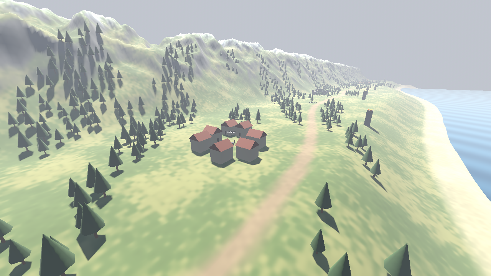 | 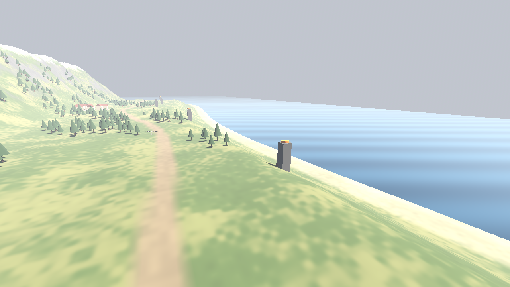 | 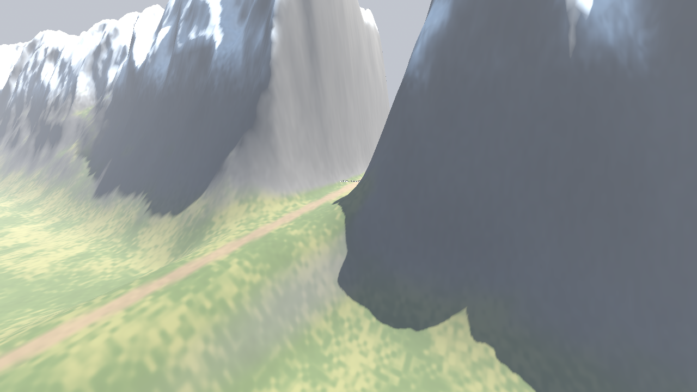 |

### Ashenveil: die dritte Region

Ashenveil, die Reiter- und Rüstburg im **Nebelmoor**, ist eine eigene Region mit dichtem Nebel. Gebaut ist sie nach deinem Grundriss, ohne Drehung.

- **Hinkommen:**
  - Innen am Südtor von Drachenstein wartet die **Reiterin Ilka Sand** aus Ashenveil. Sie nimmt Wächter über den Küstenweg mit: anderthalb Tage Spielzeit, dann eine Blende. Zurück geht es ebenso mit ihr. Anwärter nimmt sie nicht mit.
  - Du kommst am Anfang des Damms an.
- **Nur ein Weg:** Der Damm führt durch den Sumpf zur Zugbrücke am Haupttor. Wer ihn verlässt und in einen Tümpel gerät, wird zurückgesetzt: „Der Morast verschluckt jeden, der den Weg verlässt.“
- **Die Burg nach Plan:**
  - Ecktürme 27–30 und die Offenen Gänge entlang der Mauern
  - Torhaus (14) mit Fallgitter, das nur für Wächter oben ist
  - Westtrakt: Große Reithalle (1) und Marstall (2) mit Pferden, beide begehbar; dazu Futterkammern (3–5) und Heuboden (6)
  - Nordreihe: Sattlerei, Waffen- und Zeugkammer, Waffenschmiede (7–9, 19)
  - Mitte: der Überdachte Große Innenhof (10)
  - Osttrakt: Rüstkammern (11, 20), Schmieden (16, 21), Mannschaftsunterkünfte (22) und Kernspeicher (23)
  - Südtrakt: Küche (12), Vorratslager (13) und Waffenlager (15)
- **Nebeneingang im Osten:** Er hat eine Zugbrücke, ist aber verriegelt. Zwei Wachen aus zwei verschiedenen Wachgruppen stehen dort, eine Lehre aus dem Verrat von 1065.
- **Unterirdisch:**
  - Vom Innenhof führt eine Rampe hinunter zur **Kapelle der Stille (A)**. Dort steht ein Gedenkstein für den Verrat von 1065.
  - Von der Kapelle läuft der **Fluchttunnel (B)** unter Mauer und Graben hindurch bis zu einem verdeckten Ausgang im Moor.
- **Personen:** Komtur Arvid Rask im Innenhof (erzählt von 1065 und den Lehren daraus), Wachführer Henk Brask am Haupttor, die beiden Wachen am Nebeneingang und die Reiterin.

| Ashenveil vom Damm | Von oben (Norden oben) | Fluchttunnel |
|---|---|---|
| 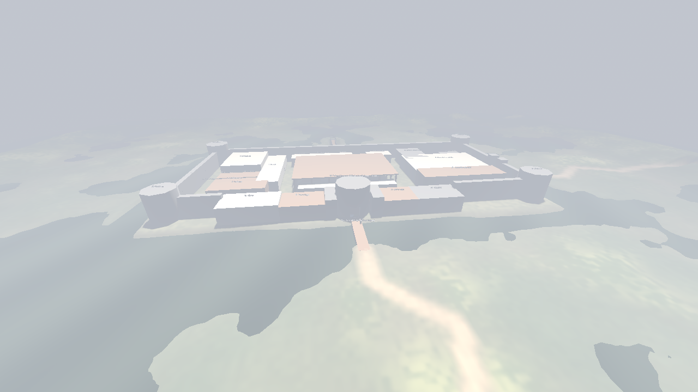 | 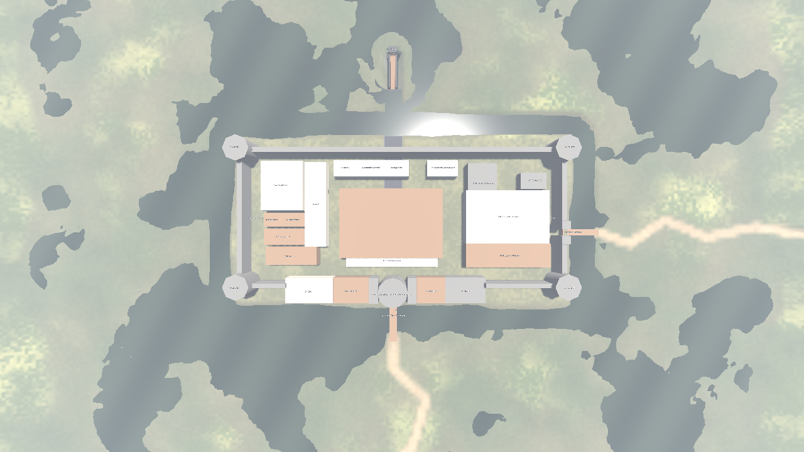 | 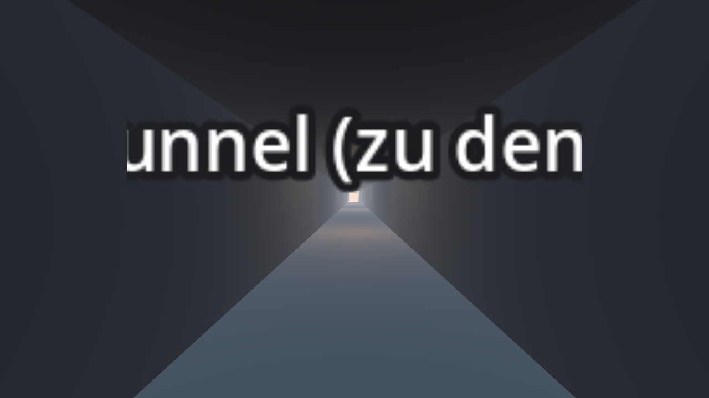 |

### Riverlock: die zweite Region

Riverlock liegt laut Karte rund 190 km Seeweg entfernt am Ostrand von Sorrowland. Deshalb ist es eine **eigene Region** mit eigenem Gelände, der **Valnschlucht**. Die Valn fließt von Norden nach Süden, dahinter steigen die Felswände an. Gebaut ist Riverlock nach deinem Grundriss, ohne Drehung.

- **Hinkommen:** Als Wächter (nach Akt I) bringt dich die **Lotsin Wenna Kroll** vom Südkai in Drachenkai nach Riverlock. Die Fahrt dauert gut zwei Tage Spielzeit, und am Ende kommt eine Blende. Zurück geht es ebenso mit ihr. Als Anwärter nimmt sie dich nicht mit.
- **Westburg (A) und Ostburg (C):**
  - Ringmauern mit runden Türmen, Äußere Toranlagen (1, 23) und Vorwerke (5, 27) zum Mittelbau.
  - In beiden Burgen: Bergfried, Großer Saal, Küchen, Kapelle, Innere Wache, Ställe, Waffenhof und Torhof.
  - Von der Ostburg geht die Straße nach Valdrenn ab.
- **Mittelbau über der Valn (B), drei Geschosse, alle begehbar, über Rampen verbunden:**
  - **unten die Hafenhalle (16):** Hier kommst du an. Kais, Stege und Boote, die Schiffsdurchfahrt durch fünf Bögen (15).
  - **in der Mitte Zoll und Kontrolle:** Lager, Wachstube und Zoll, durch sie führt der Weg vom Westlichen zum Östlichen Tor (14, 22).
  - **oben der Große Saal (20)** mit dem Ratstisch, rundum der Wehrgang (21).
  - Kettensperren von den Tortürmen zu den Ufern.
- **Personen:**
  - **Zollherr Hendrik Falk** (aus der Lore) und der **Beobachter des Ordens** im Großen Saal.
  - eine Zöllnerin im Mittelgeschoss, ein Torwächter an der Westburg, die Lotsin in der Hafenhalle.
- **Karte (M):** Der Pfeil steht in Riverlock auf Riverlock.

| Riverlock von Süden | Von oben (Norden oben) | Hafenhalle |
|---|---|---|
| 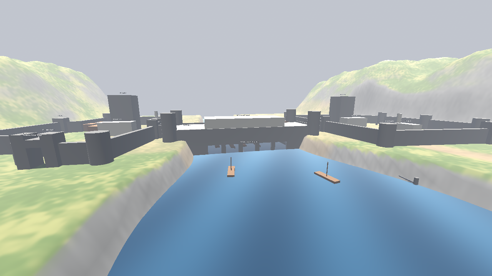 | 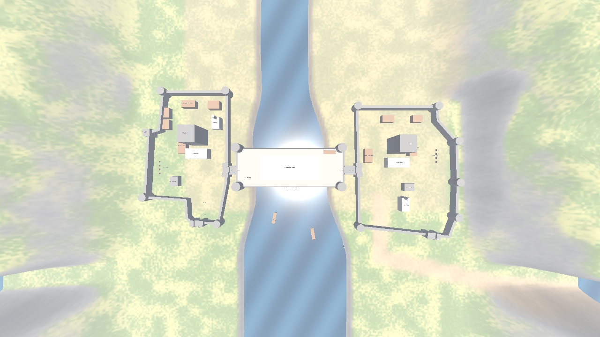 | 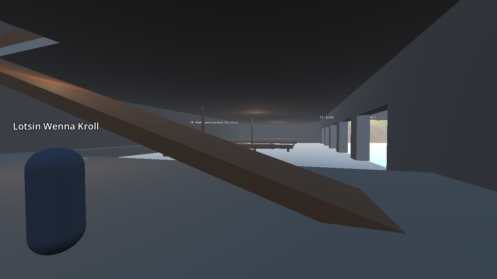 |

### Gravemarch nach Grundriss

Gebaut nach deinem Grundriss der Talburg, um 180° gedreht: Das **Äußere Torhaus (A)** zeigt nach Nordosten zum Weg aus Drachenstein, die **Kernburg (G)** liegt im Süden.

- **Aufbau:** ein aufgeschütteter Hügel im Sumpf mit Wassergraben an drei Seiten. An der Seite der Kernburg gibt es keinen Graben, wie im Plan.
- **Zugang:** Über die **Brückenpforte (2)** und die Brücke kommt man zum Torhaus.
- **Drei Ringe:**
  - die Hauptmauer mit Nordost-Bastei,
  - die **Alte Mauer (M)** mit einem Tor am **Zwinger (5)**,
  - der **Innere Wehrgang (F)** mit dem **Geknickten Tor (6)**. Hinter diesem Tor steht eine Prallwand, an der man abbiegen muss.
- **Kein gerader Weg:** Vom Torhaus geht es an der Mauer entlang durch die enge Gasse am Zwinger. Danach führt der Weg am Kapellenbezirk vorbei zum geknickten Tor und in den Burghof.
- **Viertel und Bauten:**
  - Vorburg (B), Handwerkergasse (7), Mittlerer Hof (D) mit Brunnen, Schmiedegasse (11)
  - Alter Markt (C), Mühle mit Wasserrad (22), Wachhaus (8), Speicherhof (10)
  - Kapelle St. Alriks (16), Wasserwerk (K), Zisternenhof (21), Alter Wehrturm (4)
- **Kernburg:**
  - **begehbarer Donjon (18)**, 22 m hoch, mit vier Ebenen
  - Palas mit Großer Halle (14, 15), Treppenturm (12), offene Halle im Vorhof (3)
  - **Bibliothek (17)** mit der Archivarin Ysolde Brack, die die fünf Bauphasen aus deinem Plan erzählt
- **Täuschungen:**
  - Das **unechte Südtor (23)** steht prächtig auf einer Insel im Graben, dahinter ist nur Stein.
  - Das **Tor in der Alten Mauer** am Mittleren Hof ist zugemauert.
  - Das **Südliche Vorwerk (I)** führt zu einem vermauerten Tor.
  - Die **Verborgene Pforte (19)** hinter dem Palas ist verriegelt.
  - Der **Verfallene Vorhof (L)** liegt als Ruine vor der Ostmauer.

| Gravemarch von Nordosten | Von oben (Norden oben) |
|---|---|
| 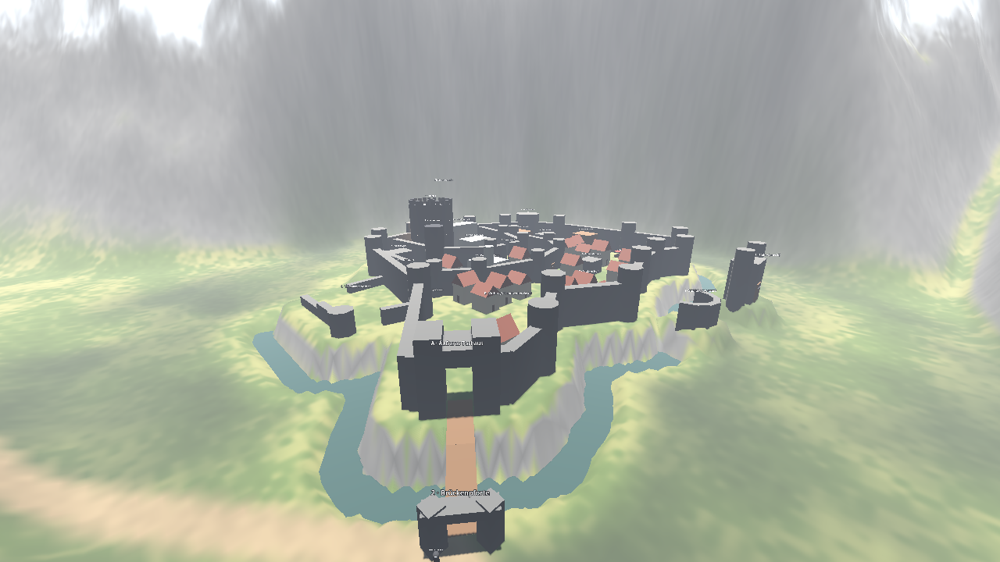 | 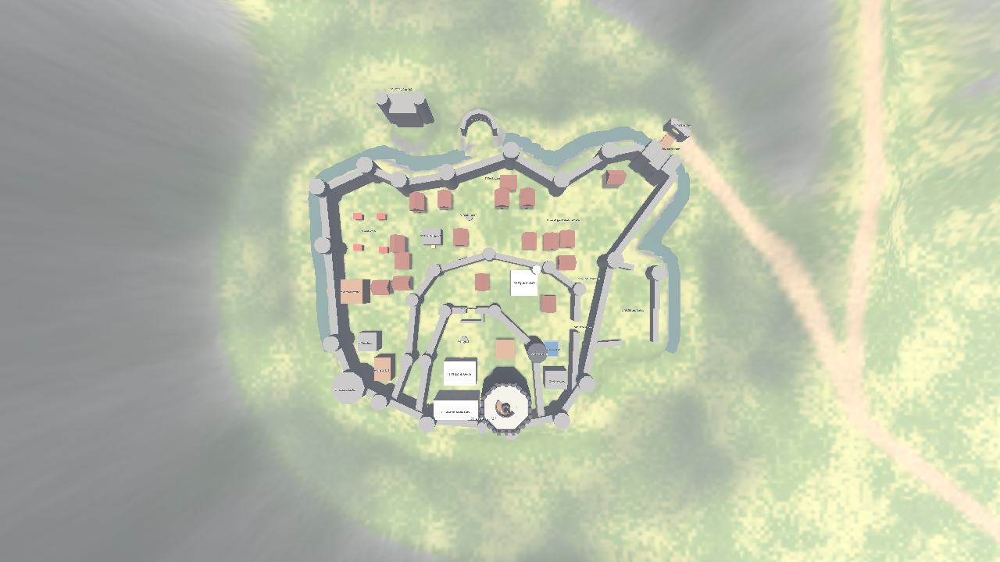 |

Deine Grundrisse liegen in [`docs/bilder/`](docs/bilder/) (`grundriss-*.webp`), auch die von Riverlock und Ashenveil.

### Burgfeste Drachenstein nach Grundriss

Inzwischen genau nach dem Grundriss neu gebaut, mit fünf gestaffelten Burgen (siehe ganz oben unter „Drachenstein nach dem echten Grundriss“). Der Hof aus Akt I liegt als Ordensvorwerk vor der Stadt am Küstenweg.

| Drachenstein vom Meer | Von oben (Norden oben) |
|---|---|
| 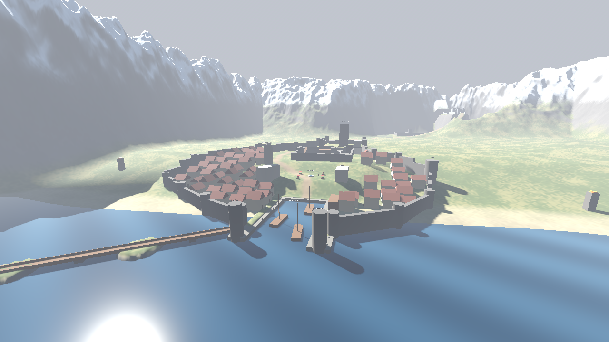 | 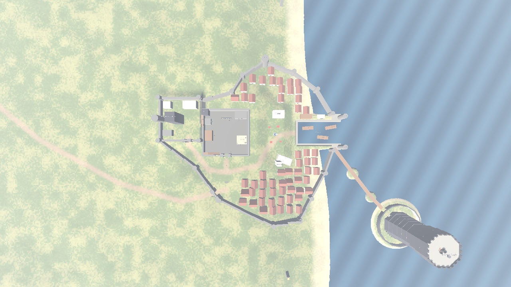 |

### Innenräume: Schwarzer Bergfried und Gravecrest

Gebaut nach deinen Grundrissen und Schnitten.

**Schwarzer Bergfried:** achteckiger Turm, 40 m breit. Die Mauern sind unten 10 m dick, im Schaft 5 m und an der Krone 3 m. Der Turm verjüngt sich nach oben und wird an der Krone wieder breiter. Alle 13 Ebenen sind begehbar, über eine **Wendelrampe um die Mittelsäule** im zentralen Treppenhaus:

| Ebene | Raum | Ebene | Raum |
|---|---|---|---|
| −4 | Sonderzellen | 3 | Ausbildung |
| −3 | Zellentrakt | 4 | **Archive** mit dem **Namensbuch** und **Hüterin der Stille Leofa Marsh** |
| −2 | Zisternen | 5 | **Stillebene**, vollständig leer |
| −1 | Interne Sicherung | 6 | Thronsaal, bewusst schlicht |
| 0 | Schwelle (Eingang von der Brücke) | 7 | Vorbereitung |
| 1 | Wachring | 8 | Observatorium |
| 2 | Unterkünfte | Dach | Zinnen und das **Feuerbecken des ersten Feuers** |

Der Unterbau liegt unter dem Meeresspiegel. Das Tor öffnet der Bergwächter erst nach dem Haupteid, dann darfst du deinen Namen im Namensbuch suchen.

**Gravecrest:** nach dem Grundriss, alle nummerierten Räume begehbar:
- **Palas-Block** mit Kaisersaal, Imperialen Gemächern, Audienzsaal, Bibliothek, Schreibstube, Garderobe, Speisesaal und der Kapelle des Sorrow, verbunden über eine Halle.
- **Oberer und Unterer Hof** mit Schmieden, Apotheken, Wachräumen, Kaserne, Akademie, Badehaus, Speichern, Ställen und Brunnenhäusern.
- Der **achteckige Donjon** trennt die Höfe. Man geht durch ihn hindurch und kann über die Wendelrampe zur Signalfeuerplattform steigen.
- **Torhaus** mit Fallgatter und Zugbrücke über den Abgrund, Flaschenzug an der Westseite.
- Im Audienzsaal sitzt **Komtur Torben Wick**.
- Das Fallgatter zieht der Kammbrecher an der Brücke erst für Wächter hoch.

| Wendelrampe im Bergfried | Archive mit Namensbuch |
|---|---|
| 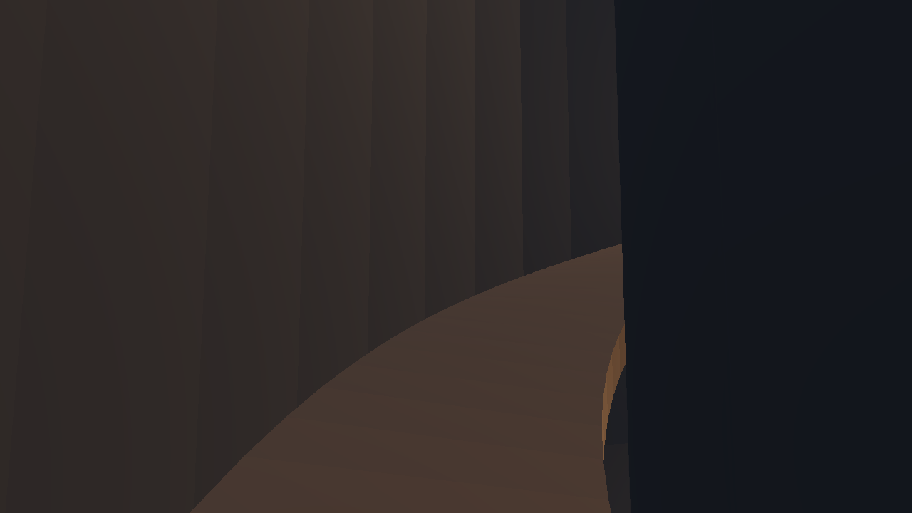 | 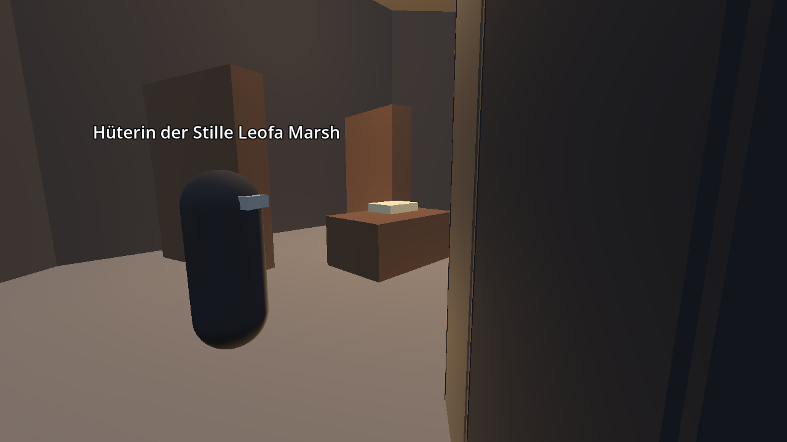 |
| **Der Schwarze Bergfried** | **Gravecrest von oben** |
| 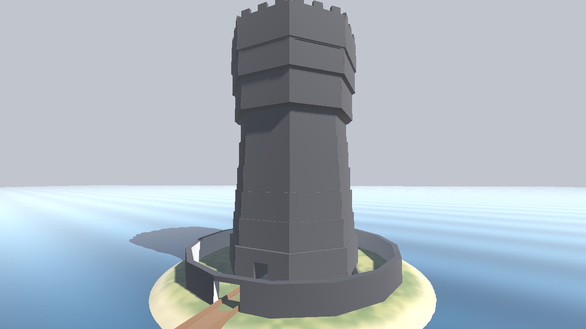 | 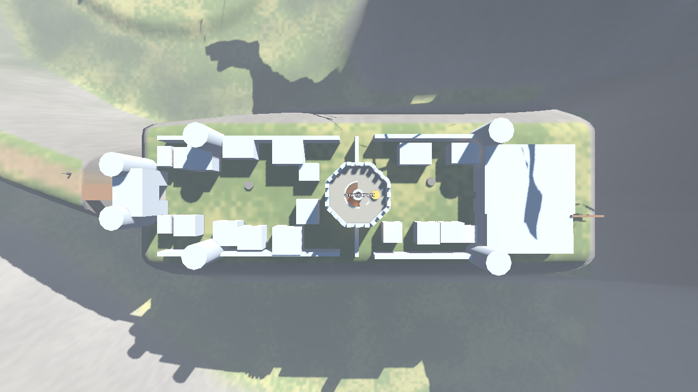 |

### Die Region Drachenstein

Die erste begehbare Region, gebaut nach deiner Karte im Maßstab **1:50** (1 km = 20 m). Gebäude sind noch Platzhalter aus einfachen Formen.

| Ort | Was dort steht |
|---|---|
| **Burgfeste Drachenstein** | nach Grundriss (siehe oben): Burgen auf dem Felsgrat (Vorburg, Mittelburg, Oberburg, Palas), Festungsstadt mit St. Marien und Markt, Drachenhafen |
| **Drachenkai** | Hafenbecken im Osten, Molen mit Hafentor und Schiffstor, Zollhaus, Schiffe, Lotsin aus Riverlock |
| **Brücken zum Bergfried** | drei Brücken von der Südmole über zwei Inseln |
| **Schwarzer Bergfried** | 100 m hoher achteckiger Turm mit Krone und äußerer Mauer, Bergwächter am Tor |
| **Gravemarch** | nach Grundriss (siehe oben): Talburg im Sumpf mit Wassergraben, drei Ringen, Scheintoren und begehbarem Donjon |
| **Gravecrest** | auf dem eisigen Felssporn (Höhe 70), Weg hinauf, Zugbrücke über den Abgrund, Torhaus, achteckiger Donjon, Palas |
| **Eisgrat** | Gebirge ringsum, Signaltürme an der Küste |

Dazu kommen:
- **Ortsnamen**, die beim Betreten groß eingeblendet werden.
- **Karte auf M** (deine Sorrowland-Karte, mit Pfeil für Position und Blickrichtung).
- **Schutz vor Meer und Rand:** Wer ins Wächtermeer fällt oder über den Rand will, wird zurückgesetzt.
- Fünf neue Personen in der Region.

| Drachenstein und Hafen | Gravecrest auf dem Felssporn |
|---|---|
|  | 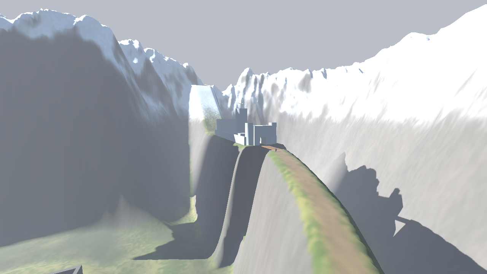 |
| **Brücken zum Schwarzen Bergfried** | **Karte (M)** |
| 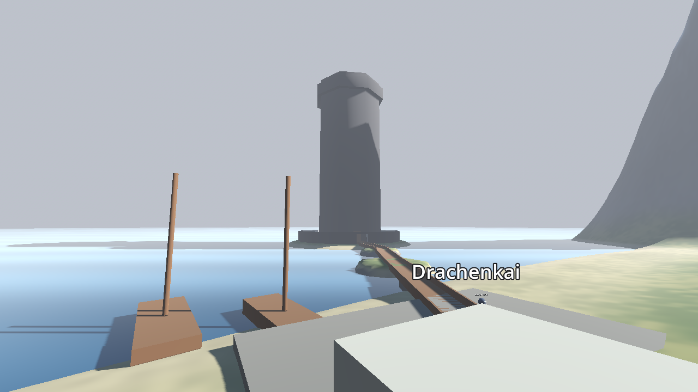 | 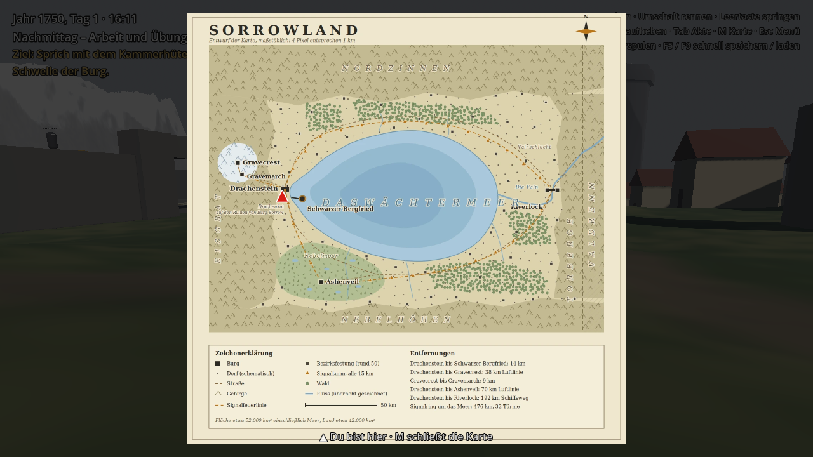 |

### Akt I – „Die Schwelle“ ist durchspielbar

Akt I spielt im Ordensvorwerk der Burgfeste Drachenstein vor der Stadt am Küstenweg und führt in etwa drei Spieljahren (1750 bis 1753) vom Bewerber bis zum Haupteid:

| Rang | Was du tust | Bei wem |
|---|---|---|
| Bewerber → **Anwärter** | Vorgespräch und Gelöbnis an der Schwelle | Kammerhüter Wendel Groth (am Tor) |
| Anwärter | Bruchsteine aus dem Bauhof, Küchendienst beim Mittagsmahl (12–13 Uhr) | Hüterin Maren Sell, Verwalterin Ilse Dorn |
| | *Das Probejahr vergeht* | |
| Knappenprüfung | **Lesen:** drei Fragen zur Ordensregel | Schreiber Odo Hesse (Schreibstube) |
| | **Handwerk:** Eckstein an der Werkbank behauen (tagsüber) | Werkmeisterin Hedda Brunn (Bauhof) |
| | **Nachtwache** neben einem Hüter bis zum Morgengrauen | Hüter Anselm Kray (Wehrgang) |
| → **Knappe** | Eid des Knappen, *zwei Lehrjahre vergehen* | Maren Sell |
| | **Torwache**, zwei Stunden, bis die Ablösung kommt | Wachführer Ivo Grend (Tor) |
| → **Geselle** | Eid des Gesellen | Maren Sell |
| | **Fenn** wirbt für die Rufer: melden, schweigen oder die Nebenpforte öffnen | Fenn, Kammerhüter |
| | **Nachtwache allein auf dem Turm**, Zustimmung von Hüterin und Wachführer | Wachturm, Maren Sell, Ivo Grend |
| → **Wächter** | Haupteid, dein Name kommt als Stein in die Ordenswand | Komtur Aldric Hayn (Ordenswand) |

Dazu kommen diese Systeme:

- **Tageszyklus** nach dem Alltag des Ordens mit Mondlicht in der Nacht. Um 19 Uhr beginnt die **Stille-Stunde**: Wer dann spricht, wird ermahnt und bekommt danach einen Verweis.
- **Dienstakte** (Tab) mit Rang, Kordel, Bürge und allen Einträgen. Verweise färben sie rot, und bei Beförderungen zögert dann die Versammlung.
- **Wachposten:** Wer einen Posten vor der Ablösung verlässt, bekommt einen Verweis („Nicht früher, nicht später.“).
- **Ziel-Anzeige** oben links, damit du immer weißt, was als Nächstes kommt.
- **Kordel am Kragen** der Spielfigur je nach Rang: keine, schwarz, grau oder golden.
- **Drei Ausgänge für Fenn:** Wer meldet, bleibt sauber. Wer schweigt, bekommt einen Verweis, und der Bürge wird mitverhandelt. Wer die Pforte öffnet, wird verbannt, und das Spiel endet.
- **Speichern und Laden** (siehe unten).

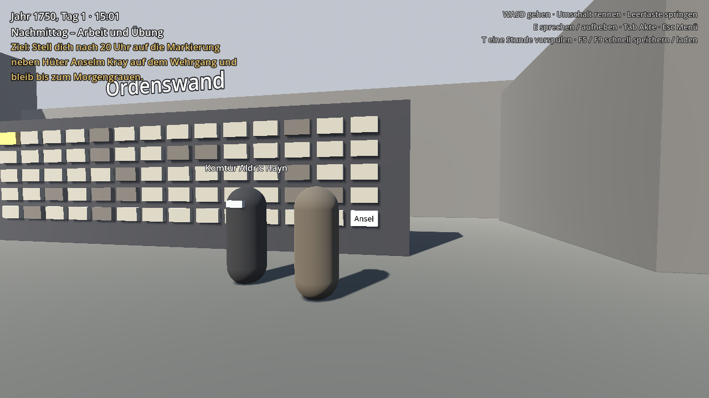

## Starten

1. **Godot 4.7** (oder neuer) herunterladen: <https://godotengine.org/download>
   Die **Standardversion** nehmen, nicht die .NET-Version. Godot muss nicht installiert werden, die Datei einfach entpacken und starten.
2. Im Projektmanager auf **Importieren** klicken und die Datei `project.godot` aus diesem Ordner wählen.
3. Im Editor oben rechts auf **▶ (Projekt starten)** klicken oder **F5** drücken. Das Spiel beginnt im Hauptmenü.

## Steuerung

| Taste | Aktion |
|---|---|
| W A S D | gehen |
| Umschalt | rennen |
| Leertaste | springen |
| Maus | Kamera |
| E | sprechen, aufheben, arbeiten, im Gespräch weiter |
| 1–9 | Antwort wählen (oder mit der Maus klicken) |
| Tab | Dienstakte ein/aus |
| M | Karte ein/aus |
| T | eine Stunde vorspulen (praktisch für Nachtwachen) |
| Esc | Pausemenü: Speichern, Laden, Hauptmenü |
| F5 / F9 | schnell speichern / schnell laden (im laufenden Spiel) |
| F | Waffe ziehen / wegstecken |
| Q | Säbel oder Muskete |
| linke Maustaste | Hieb, Schuss, ungeladen Bajonett |
| rechte Maustaste | blocken (Säbel) |
| R | Muskete nachladen (acht Sekunden) |
| Strg | schleichen (zum Belauschen) |
| F10 | Entwicklermenü (nur beim Start aus dem Editor): zu Orten springen, Uhrzeit, in eine andere Region reisen, Alarmstufe, alle Tore öffnen, Akt I überspringen |

Den Wehrgang erreichst du über die Holzrampe an der Südmauer, westlich vom Tor. Von dort führt die Westmauer zur zweiten Rampe hinauf auf den Wachturm in der Nordwestecke.

Wege durch die Region: Vom Ordensvorwerk (Hof aus Akt I) führt der Küstenweg nach Norden und am Ufer unter der Stadtmauer zum Südtor. Aus der Oberburg geht es durch den Zwinger, die Mittelburg und die Rampe hinab, durch die Vorburg und im Bogen durch die Stadt zum Markt. Vom Markt kommt man auf den Westkai des Drachenhafens, an der Molenpforte auf die Mole und über die Brücken zum Bergfried. Nach Gravemarch geht es durch das Nordtor ins Tal bis zur Brückenpforte von Gravemarch; kurz davor zweigt der Weg nach Norden ab und steigt auf den Felssporn nach Gravecrest.

## Speichern und Laden

- **Hauptmenü:** Fortsetzen (neuester Spielstand), Neues Spiel (mit deinem Namen), Laden, Beenden.
- **Pausemenü (Esc):** drei Speicherplätze, Laden aus allen Plätzen.
- **Automatisch** wird nach jedem Rangwechsel und jedem Zeitsprung gespeichert.
- **Schnellspeichern** mit F5, schnell laden mit F9.
- Gespeichert werden Name, Rang, Akte, Flags, Zähler, Ziel, Uhrzeit und Jahr, die Region, Position und Blickrichtung sowie aufgehobene Gegenstände.
- Die Dateien liegen als lesbares JSON im Godot-Benutzerordner unter `speicher/`. Unter Windows ist das `%APPDATA%\Godot\app_userdata\Sorrowland_ In Silentio\speicher\`. In Godot öffnest du den Ordner über **Projekt → Benutzerdatenordner öffnen**.

## Projektaufbau

```
project.godot              Projekteinstellungen, Tastenbelegung, Autoloads
autoload/                  immer geladene Spielsysteme
  spielzeit.gd             Uhrzeit, Jahr, Tagesabschnitte, Stille-Stunde, Zeitsprünge
  spielstand.gd            Name, Rang, Akte, Verweise, Flags, Zähler, Ziel, Bedingungen
  dialog.gd                liest und führt die Gespräche aus daten/dialoge/
  speicher.gd              Speichern, Laden, neues Spiel, Reisen zwischen Regionen
  ereignisse.gd            was mit der Zeit geschieht: Sold, Prüfer, Folgen einer Bürgschaft
szenen/
  oberflaeche/hauptmenue.tscn  Startszene
  oberflaeche/pausemenue.tscn  Esc-Menü
  oberflaeche/hud.tscn     Uhr, Ziel, Hinweise, Gesprächsfenster, Akte, Blenden
  welt/region_drachenstein.tscn  Region Drachenstein: Gelände, Meer, Burgen, Brücken, Orte, Personen
  welt/region_riverlock.tscn     Region Riverlock: Valnschlucht, Westburg, Mittelbau, Ostburg
  welt/region_ashenveil.tscn     Region Ashenveil: Nebelmoor, Burg, Kapelle der Stille, Fluchttunnel
  welt/region_nordstrasse.tscn, region_suedstrasse.tscn, region_kuestenweg.tscn  die Landstraßen
  welt/uebergang.gd        Übergang am Ende eines Weges in die nächste Region
  welt/gespraech.gd        belauschbares Gespräch zwischen zwei Personen
  welt/durchsuchbar.gd     heimlich durchsuchbar (z. B. ein Pult), solange niemand herübersieht
  welt/bedingt_sichtbar.gd sichtbar unter einer Bedingung, z. B. Signalfeuer ab Alarmstufe 2
  welt/wasserdicht.gd      Bereich unter dem Wasserspiegel, in dem niemand zurückgesetzt wird (Keller, Tunnel)
  welt/region.gd           Wurzel einer Region: Wasser, Rand, Lage auf der Karte
  welt/gelaende.gd         baut Gelände und Kollision aus daten/gelaende*/
  welt/burg_hof.tscn       der Hof aus Akt I (Ordensvorwerk) mit seinen Personen und Posten
  welt/gelaende.gdshader   Gelände aus Texturen: Gras, Erde, Fels, Sand, Schnee, Sumpf, Wege, Pflaster
  welt/wasser.gdshader     das Wächtermeer
  welt/auf_gelaende.gd     setzt Häuser und Personen auf die Geländehöhe
  welt/ort.gd              benannter Ort, zeigt beim Betreten den Namen
  welt/haus.tscn           einfaches Haus (Gravemarch)
  welt/stadthaeuser.gd     Bürgerhäuser einer Stadt: 24 Fachwerk- und Steinhausformen als MultiMesh
  welt/bewuchs.gd          Bäume, Büsche, Felsen und Gras einer Region (bewuchs.gdshader: Farbe und Wind)
  welt/turm.gd             begehbarer achteckiger Turm: Ebenen, Wendelrampe, Türen, Zinnen
  welt/tor.gd              Tor, das sich erst unter einer Bedingung öffnet
  welt/lesbar.gd           Gegenstand zum Lesen oder Ansehen (Namensbuch, Feuerbecken)
  oberflaeche/entwickler.tscn  Entwicklermenü (F10)
  welt/tageslicht.gd       Sonne, Mond, Himmel und Nebel nach Uhrzeit
  welt/ordenswand.gd       Namenssteine, nach dem Haupteid auch deiner
  welt/posten.gd           Wachposten (Torwache, Nachtwachen)
  spieler/                 Spielfigur und Kamera, spieler/kampf.gd: Waffen, Leben, Verwundung
  figuren/gegner.tscn      Gegner (Gesetzlose mit Säbel oder Muskete, Übungspuppe)
  figuren/person.tscn      ansprechbare Person
  figuren/figur.gd         Mensch aus Gliedern mit Gehanimation (Personen, Spieler, Gegner)
  figuren/bruchstein.tscn  Gegenstand zum Aufheben
  figuren/werkbank.tscn    Arbeitsstelle (kostet Spielzeit)
daten/dialoge/             Gespräche als JSON-Dateien
daten/drachenstein_plan.json      Grundriss von Drachenstein in Weltkoordinaten (aus werkzeuge/bau/plan_drachenstein.py, der Geländeerzeuger liest ihn)
texturen/                  Fotoscans (werkzeuge/texturen_laden.py, Quellen in groessen.json) und Wolken
material/                  Materialien aus diesen Texturen (triplanar, in Weltgröße)
daten/gelaende/            Höhen (hoehen.r32), Wege und Sumpf (maske.png), Vorschau der Region Drachenstein
daten/gelaende_riverlock/  dasselbe für Riverlock
daten/gelaende_ashenveil/  dasselbe für Ashenveil
daten/gelaende_<straße>/   dasselbe für Nordstraße, Südstraße und Küstenweg
daten/karten/              die Karte von Sorrowland für die Taste M
werkzeuge/                 Gelände-Generatoren (in Godot ausführbar)
werkzeuge/bau/             Bauskripte (Python), aus denen die Regionsszenen entstehen
tests/                     automatische Tests
docs/                      Lore-Bibel, Spielkonzept, Karten, Bilder (von Godot ignoriert)
```

## Eine neue Person hinzufügen

1. `szenen/welt/region_drachenstein.tscn` öffnen (für den Hof: `szenen/welt/burg_hof.tscn`).
2. `szenen/figuren/person.tscn` aus dem Dateisystem-Dock in die Szene ziehen. In der Region unter **Personen/PersonenAmBoden** setzt sie sich von selbst auf die Geländehöhe.
3. Im Inspektor ausfüllen:
   - **Anzeige Name**
   - **Dialog Id** (Dateiname ohne `.json`)
   - **Kordel** (Rang)
   - **Tracht** (Farbe)
   - optional **Sichtbar Wenn**, eine Bedingung, solange die Person da ist
   - optional **Tagesablauf**: eine Zeile je Tagesabschnitt, z. B. `vormittag: 60,-8,24; 64,-8,-1` (Wegpunkte x,y,z), dahinter mit `|` Zusätze:
     - `weg`: danach ist die Person fort, im Haus
     - `runde`: die Wegpunkte immer wieder; `runde=2` heißt erst hingehen, dann ab dem dritten Punkt
     - `blick=180`: Blickrichtung am Ziel
   - optional **Tempo** in m/s
4. Eine Datei `daten/dialoge/<dialog_id>.json` anlegen (siehe unten).

Die Regionsszenen werden aus den Bauskripten erzeugt (siehe „Die Regionsszenen neu bauen“). Eine Person, die du dort im Editor hinzufügst, bleibt nur bis zum nächsten Neubau. Soll sie dauerhaft bleiben, gehört sie in das Bauskript der Region.

## Das Gelände verändern

Das Gelände von Drachenstein wird aus `werkzeuge/gelaende_erzeuger.gd` erzeugt, das von Riverlock aus `werkzeuge/gelaende_riverlock.gd`, das von Ashenveil aus `werkzeuge/gelaende_ashenveil.gd`, die drei Straßen aus `werkzeuge/gelaende_strasse.gd`. `werkzeuge/gelaende_erzeugen.gd` erzeugt alle. Dort stehen die Lage der Orte, die Wege, das Gebirge, der Felssporn, die Küste und die Inseln, jeweils mit Kommentar.

1. Werte im Erzeuger ändern, z. B. einen Weg oder die Höhe des Felssporns.
2. `werkzeuge/gelaende_erzeugen.gd` öffnen und **Datei → Ausführen** wählen (Strg+Umschalt+X).
3. Die Szene `region_drachenstein.tscn` neu öffnen.

`daten/gelaende/vorschau.png` (und `daten/gelaende_riverlock/vorschau.png`) zeigt das Ergebnis von oben. Signaltürme und Personen unter einem Knoten mit `auf_gelaende.gd` (Signaltuerme, PersonenAmBoden) folgen der neuen Geländehöhe von selbst. Die Bauten von Drachenstein (Ringmauer, Stadthäuser, Kirche) haben feste Höhen, die beim Bau der Szene aus dem Gelände gelesen wurden. Wer das Gelände um Drachenstein ändert, verschiebt sie im Editor mit oder baut die Szene neu (siehe unten).

## Die Regionsszenen neu bauen

Die großen Bauten (Burgen nach Grundriss, Ringmauern, Stadthäuser, Mittelbau) entstehen nicht von Hand, sondern aus Python-Skripten in `werkzeuge/bau/`. Sie schreiben die Szenendateien neu:

```
python3 werkzeuge/bau/region_drachenstein.py   # schreibt szenen/welt/region_drachenstein.tscn
python3 werkzeuge/bau/region_riverlock.py      # schreibt szenen/welt/region_riverlock.tscn
python3 werkzeuge/bau/region_ashenveil.py      # schreibt szenen/welt/region_ashenveil.tscn
python3 werkzeuge/bau/region_strasse.py        # schreibt die drei Landstraßen
python3 werkzeuge/dialoge_stadt.py             # schreibt die Alltagsdialoge der Stadtleute
python3 werkzeuge/texturen_laden.py            # lädt die Fotoscans (Poly Haven, ambientCG) nach texturen/
python3 werkzeuge/texturen_erzeugen.py material  # schreibt material/*.tres (Steine mit stein.gdshader)
python3 werkzeuge/texturen_erzeugen.py         # erzeugt nur die Wolken neu
```

Prüfen ohne zu schreiben: `BAU_NUR_PRUEFEN=1 python3 werkzeuge/bau/region_drachenstein.py`. Mit zusätzlich `BAU_KARTE=plan.png` zeichnet das Skript einen Lageplan der Stadt mit Straßen, Häusern und Mauern.

Die Stadtleute von Drachenstein entstehen in `teil_stadtleben.py`: `stadtmensch(...)` mit Wohnung und einem Plan je Tagesabschnitt (Ziel, `"heim"` oder eine `runde(...)`). Die Wege dazwischen sucht das Skript über das Wegenetz. Führt einer durch ein Haus, einen Stand oder den Brunnen, gibt es beim Bauen eine Warnung.

Dafür braucht es Python 3 mit `numpy`. `grundlage.py` enthält die gemeinsamen Bausteine (Mauerzug, Tor, Raum, Rampe ...), die `teil_*.py` die einzelnen Burgen. Die Skripte lesen die Geländehöhen, also zuerst das Gelände erzeugen, dann bauen. **Achtung:** Was du in diesen Szenen im Editor änderst, ist nach dem Neubau weg. Größere Änderungen gehören deshalb in die Skripte.

## Einen Turm bauen

`szenen/welt/turm.gd` baut aus einer Liste von Ebenen einen begehbaren achteckigen Turm, auch im Editor. Im Inspektor einstellen:

| Wert | Bedeutung |
|---|---|
| Ebenen Nummern / Namen | z. B. −4 bis 8, „Archive“, „Stillebene“ |
| Boden Hoehen | Höhe jedes Bodens, ein Eintrag mehr als Ebenen (der letzte ist das Dach) |
| Aussen Radien / Wandstaerken | je Ebene, so entstehen Verjüngung und Krone |
| Eingaenge | Türen in der Außenmauer: (Ebene, Winkel) |
| Treppen Winkel | Richtung der Türen zum Treppenhaus |
| Wasserdicht | Turm reicht unter den Meeresspiegel (keine Rettung aus dem Wasser innen) |

Jede Ebene bekommt automatisch Licht und ein Schild „Ebene X · Name“. Vorlagen sind der Bergfried und der Donjon von Gravecrest. Die Rampe bleibt flacher als 35°, wenn die Mittelsäule dick genug ist (Bergfried 1,9 m, Donjon 1,4 m).

## Einen Wachposten hinzufügen

Einen `Area3D`-Knoten mit dem Skript `szenen/welt/posten.gd` und einer `CollisionShape3D` anlegen. Im Inspektor einstellen:
- **Bedingung:** wann der Posten zählt
- **Erledigt Flag:** welches Flag am Ende gesetzt wird
- **Dauer Minuten** oder **Bis Abschnitt** (z. B. `morgengrauen`)
- die Texte für Beginn, Mitte und Ende

Vorlagen sind die drei Posten unter **Posten** im Hof.

## Dialoge schreiben

Jede Datei hat Knoten. Begonnen wird beim Knoten `start`, außer ein Eintrag in `einstieg` passt. Diese werden von oben nach unten geprüft, der erste passende gewinnt. Deshalb gehören die späten Spielabschnitte nach oben.

```json
{
	"einstieg": [
		{ "bedingung": "geloebnis", "knoten": "danach" }
	],
	"knoten": {
		"start": {
			"text": "Was die Person sagt. {name} wird durch den Namen des Spielers ersetzt.",
			"optionen": [
				{ "text": "Antwort 1", "weiter": "zweiter_knoten" },
				{ "text": "Antwort 2", "bedingung": "fenn_fragte,!fenn_gemeldet", "setze": ["neues_flag"] }
			]
		},
		"zweiter_knoten": {
			"text": "Ohne Antworten geht es mit E weiter oder das Gespräch endet.",
			"ziel": "Neues Ziel für die Anzeige oben links.",
			"weiter": "danach"
		},
		"danach": { "text": "Wach gut." }
	}
}
```

**Felder in Knoten und Antworten:**

| Feld | Wirkung |
|---|---|
| `text` | gesprochener Text. `{name}` und `{buerge}` werden ersetzt. Als Liste sagt die Person eine der Zeilen, fest je Person und Tag. Ein Eintrag kann `{"text": ..., "bedingung": ...}` sein und zählt dann nur, wenn die Bedingung gilt |
| `sprecher` | anderer Sprechername als die Person (nur Knoten) |
| `weiter` | nächster Knoten. Fehlt er, endet das Gespräch |
| `bedingung` | nur bei Antworten und Einstiegen: wann sie sichtbar oder gültig sind |
| `setze` | Liste von Flags, die gesetzt werden |
| `akte` | Eintrag in die Dienstakte |
| `verweis` | Verweis (Stufe 1) in die Akte, zählt `verweise` hoch |
| `zaehler` | Zähler ändern, z. B. `{ "bruchsteine": -3 }` |
| `rang` | Rang setzen (0 Bewerber, 1 Anwärter, 2 Knappe, 3 Geselle, 4 Wächter …) |
| `ziel` | neues Ziel oben links |
| `meldung` | kurze Einblendung oben im Bild |
| `zeitsprung` | `{ "jahre": 2, "text": "Zwei Jahre vergehen." }` mit schwarzer Blende |
| `blende` | schwarze Blende mit Text, danach geht es weiter |
| `akt_ende` | lange Blende zum Ende eines Akts |
| `spielende` | Blende, danach zurück ins Hauptmenü |
| `ansehen` | Ansehen ändern, z. B. `{ "doerfer": 10, "treue": -3 }` (treue, zweifler, rufer, doerfer, riverlock, stadt) |
| `alarm` | Alarmstufe setzen (0–3) |
| `anzeige` | `{ "stufe": 2, "grund": "..." }`: Anzeige beim Kammerhüter (2 Degradierung bis 5 Verbannung) |
| `urteil` | `true`: das Urteil im laufenden Verfahren vollstrecken (nur beim Kammerhüter) |
| `geld` | Geld in Hellern ändern, z. B. `240` (ein Gulden) oder `-240` |
| `merke_tag` | Name eines Zählers, der den heutigen Tag festhält, z. B. für Fristen in `autoload/ereignisse.gd` |
| `reise` | `{ "ziel": "riverlock", "ankunft": "von_drachenstein", "stunden": 54, "text": "..." }`: Am Ende des Gesprächs geht es in die andere Region, an den Marker mit diesem Namen (Gruppe `ankunft`), die Zeit läuft weiter, dann kommt die Blende mit dem Text |

**Bedingungen:** `flag` (gesetzt), `!flag` (nicht gesetzt), `zaehler>=3`, `zaehler<3`, `rang>=2`, `alarm>=2`, `ansehen_rufer>=10`, `verfahren_stufe>=4`, `abschnitt=mittag` (morgengrauen, vormittag, mittag, nachmittag, stille_stunde, nacht), `abschnitt!=nacht`, `region=riverlock` (die Region, in der man gerade ist: drachenstein, riverlock, ashenveil, nordstrasse, suedstrasse, kuestenweg). Mehrere werden durch Komma getrennt und müssen alle gelten.

## Testen

Elf automatische Tests, alle mit eigenem Speicherordner, sodass deine Spielstände unberührt bleiben:

| Test | Prüft |
|---|---|
| `tests/test_akt1.gd` | Akt I komplett, 42 Punkte: falsche Antworten, zu früh verlassener Posten, Speichern und Laden, alle drei Ausgänge des Fenn-Strangs |
| `tests/test_eingabe.gd` | echte Tastendrücke: E zum Ansprechen und Aufheben, Zifferntasten im Gespräch |
| `tests/test_innen.gd` | die Innenräume, 25 Punkte, mit echtem Gehen: Bergfried-Tor zu und auf, Wendelrampe hinauf aufs Dach und hinunter bis Ebene −4, Namensbuch, Hüterin, Feuerbecken, Fallgatter, Torhaus, durch den Donjon und hinauf, Torben Wick, Entwicklermenü, in Gravemarch Donjon, Archivarin und Scheintore |
| `tests/test_leben.gd` | Leben in der Welt, 30 Punkte: über 50 Personen, Markt am Vormittag, Kinder um den Brunnen dem Boden folgend, nachts im Haus und Nachtstreife, Wachwechsel, Gehen vor den Augen des Spielers ohne zu schweben, Stehenbleiben im Gespräch, wechselnde Zeilen, Gerüchte, leere Märkte bei Alarm, Stille-Stunde, Speichern und Laden |
| `tests/test_akt2.gd` | Akt II, Nachrichtenkette, 36 Punkte: Zeitsprung beim Komtur, Leofa und die Siegelhülse, der Beobachter, das Pult tagsüber bewacht und nachts durchsucht, Speichern und Laden, alle Ausgänge (Falk liefert aus, der Rat entscheidet, Falk verweigert, Gold genommen und nach fünf Tagen angezeigt, gestanden) |
| `tests/test_spaehwesen.gd` | Sold, Spähwesen und Bürgschaft, 22 Punkte: Sold zum Monatsanfang und doppelt im Krieg, Bürgschaft für Kerrin, offen von vorn bemerkt werden, schleichend alles hören, Kerrin als Bürge melden, Gold vom Gesandten, Gespräch über die Kette belauschen und berichten, Gold melden, Speichern und Laden, Anzeige durch die Prüfer bei nicht gemeldetem Gold, Verweis für den schweigenden Bürgen |
| `tests/test_stufe4.gd` | Stufe 4, 28 Punkte: Alarmstufe 1 zu Beginn, Ansehen durch Antworten, Auftrag und Kampf gegen die Gesetzlosen (Treffer, Block, Sieg, bleiben nach dem Laden liegen), Verwundung, Ring der Feuer und leere Märkte, keine Boote bei Alarm, Säbel, Schuss, Bajonett, Nachladen, Verweise und Verfahren bis zur Degradierung, Waffe gegen die Händlerin bis zur Ausstoßung |
| `tests/test_landwege.gd` | die Landwege, 26 Punkte: Anwärter bleiben drin, vom Nordtor am Burgberg entlang, einmal um das Meer (Nordstraße, Südstraße, Küstenweg) mit den richtigen Reisetagen, Umkehren kostet nichts, Karte, Wald, Personen an der Straße, Speichern und Laden unterwegs, über den Pass und den Küstenweg durch das Südtor zurück in die Stadt |
| `tests/test_ashenveil.gd` | Ashenveil, 24 Punkte: Reiterin lehnt Anwärter ab, Ritt hin und zurück mit Zeitverlust, Morast, über den Damm und durch das Fallgitter, Rampe hinunter in die Kapelle, Gedenkstein, durch den Fluchttunnel ins Moor, Personen, verriegelter Nebeneingang, Speichern und Laden |
| `tests/test_riverlock.gd` | Riverlock und das Reisen, 21 Punkte: Lotsin lehnt Anwärter ab, Überfahrt hin und zurück mit Zeitverlust, Rampen durch alle drei Geschosse des Mittelbaus, Zollherr in der Akte, Personen, Wege durch beide Burgen bis vor die Tore, Wasser, Speichern und Laden in Riverlock, Reise über das Entwicklermenü |
| `tests/test_region.gd` | die Region, 38 Punkte: Gelände, Gehen durch das Tor und über Rampen und Brücken, vom Markt durch Stadt, Vorburg, Mittelburg, Zwinger und Oberburg hinauf in den Palas, außen um den Palas hinab zur Rampe, der Zwingerweg um die Oberburg, über den Kai auf den Landungssteg, durch den Untergrundhafen auf den Ostkai zu den Kränen, in alle begehbaren Gebäude und ihre Treppen hinauf, durch die Molenpforte auf die Mole, die Landwege durch Nordtor und Südtor in die Stadt, durch das Labyrinth von Gravemarch, Ortsnamen, Meer und Rand, alle fünf neuen Personen, Karte, Speichern und Laden, Umzug alter Spielstände |

```
godot --headless --path . --script res://tests/test_akt1.gd
godot --headless --path . --script res://tests/test_eingabe.gd
godot --headless --path . --script res://tests/test_region.gd
godot --headless --path . --script res://tests/test_innen.gd
godot --headless --path . --script res://tests/test_riverlock.gd
godot --headless --path . --script res://tests/test_ashenveil.gd
godot --headless --path . --script res://tests/test_landwege.gd
godot --headless --path . --script res://tests/test_stufe4.gd
godot --headless --path . --script res://tests/test_spaehwesen.gd
godot --headless --path . --script res://tests/test_akt2.gd
godot --headless --path . --script res://tests/test_leben.gd
```

Am Ende steht jeweils `Fehler: 0`, wenn alles stimmt.

## Nächste Schritte

Siehe Fahrplan in [`docs/02-spielkonzept.md`](docs/02-spielkonzept.md), Abschnitt 8. Alle Burgen aus deinen Grundrissen stehen, die Landwege verbinden sie, und die Systeme aus Stufe 4 laufen. Stufe 4 ist damit vollständig. Akt II hat begonnen: Der erste Hauptfaden, die Nachrichtenkette in Riverlock, ist spielbar. Offen sind die übrigen Fäden von Akt II (die zwei im Rat, Silas Holt, das Archiv) und echte Modelle statt Klötzen (Stufe 3).
