# Sorrowland: In Silentio

> *In silentio vigilamus. Aber wenn die Stille endet, handeln wir.*

Ein Open-World-Rollenspiel im Sorrowland des Jahres 1750: Du trittst als Vertriebener an die Schwelle des Ordo Custodum und steigst vom Anwärter zum Wächter auf, während die 620 Jahre alte Stille zu zerbrechen droht.

- Lore: [`docs/01-lore-bibel.md`](docs/01-lore-bibel.md)
- Spielkonzept und Fahrplan: [`docs/02-spielkonzept.md`](docs/02-spielkonzept.md)
- Karten: [`docs/bilder/`](docs/bilder/)

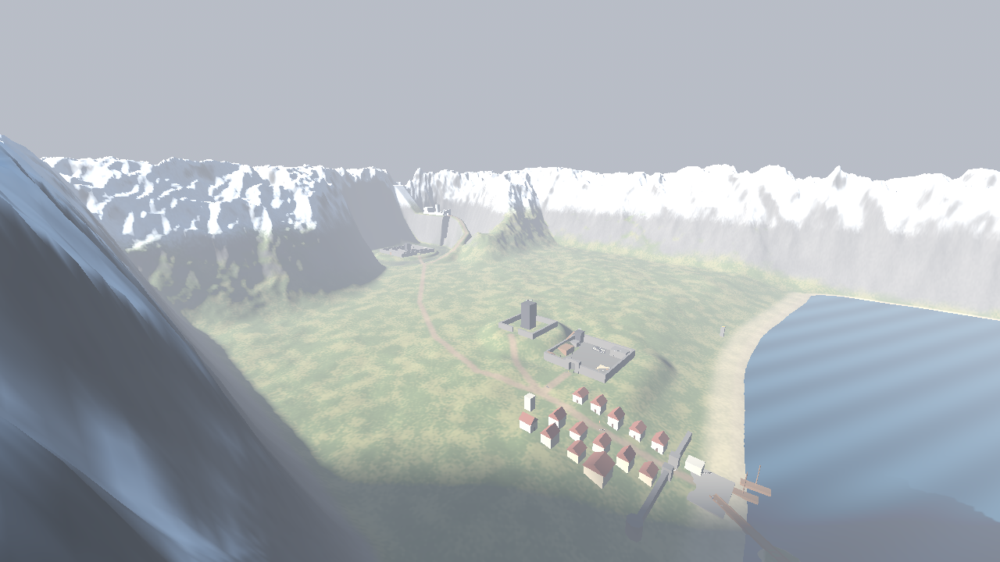

## Stand

### Gravemarch nach Grundriss

Gebaut nach deinem Grundriss der Talburg, um 180° gedreht: Das **Äußere Torhaus (A)** zeigt nach Nordosten zum Weg aus Drachenstein, die **Kernburg (G)** liegt im Süden.

- **Aufbau:** ein aufgeschütteter Hügel im Sumpf mit Wassergraben an drei Seiten. An der Seite der Kernburg gibt es keinen Graben, wie im Plan.
- **Zugang:** Über die **Brückenpforte (2)** und die Brücke kommt man zum Torhaus.
- **Drei Ringe:**
  - die Hauptmauer mit Nordost-Bastei,
  - die **Alte Mauer (M)** mit einem Tor am **Zwinger (5)**,
  - der **Innere Wehrgang (F)** mit dem **Geknickten Tor (6)**. Hinter diesem Tor steht eine Prallwand, an der man abbiegen muss.
- **Kein gerader Weg:** Vom Torhaus geht es an der Mauer entlang durch die enge Gasse am Zwinger. Danach führt der Weg am Kapellenbezirk vorbei zum geknickten Tor und in den Burghof.
- **Viertel und Bauten:**
  - Vorburg (B), Handwerkergasse (7), Mittlerer Hof (D) mit Brunnen, Schmiedegasse (11)
  - Alter Markt (C), Mühle mit Wasserrad (22), Wachhaus (8), Speicherhof (10)
  - Kapelle St. Alriks (16), Wasserwerk (K), Zisternenhof (21), Alter Wehrturm (4)
- **Kernburg:**
  - **begehbarer Donjon (18)**, 22 m hoch, mit vier Ebenen
  - Palas mit Großer Halle (14, 15), Treppenturm (12), offene Halle im Vorhof (3)
  - **Bibliothek (17)** mit der Archivarin Ysolde Brack, die die fünf Bauphasen aus deinem Plan erzählt
- **Täuschungen:**
  - Das **unechte Südtor (23)** steht prächtig auf einer Insel im Graben, dahinter ist nur Stein.
  - Das **Tor in der Alten Mauer** am Mittleren Hof ist zugemauert.
  - Das **Südliche Vorwerk (I)** führt zu einem vermauerten Tor.
  - Die **Verborgene Pforte (19)** hinter dem Palas ist verriegelt.
  - Der **Verfallene Vorhof (L)** liegt als Ruine vor der Ostmauer.

| Gravemarch von Nordosten | Von oben (Norden oben) |
|---|---|
| 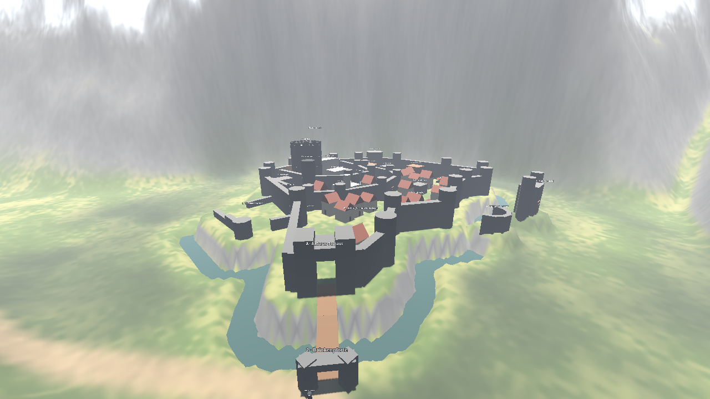 | 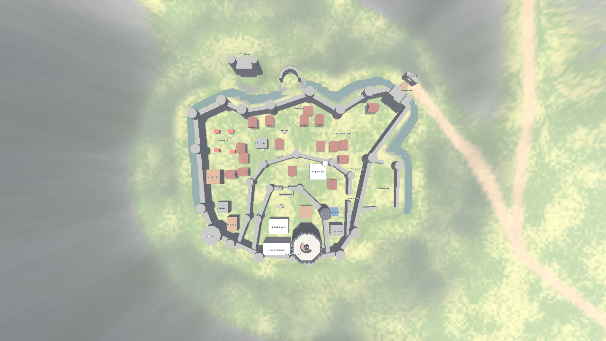 |

Deine Grundrisse liegen in [`docs/bilder/`](docs/bilder/) (`grundriss-*.webp`), auch die von Riverlock und Ashenveil.

### Burgfeste Drachenstein nach Grundriss

Gebaut nach deinem Grundriss, **gedreht**: Der Süden des Plans liegt jetzt im Osten, der Hafen öffnet sich zum Wächtermeer.

- **Mittlere Burg:** der Hof aus Akt I, unverändert.
- **Oberer Burg (Drachenhorst)** im Westen, auf Höhe der Hofmauerkrone (8 m), mit eigener Ringmauer, Tor im Süden, Urkern, Aussichtsplattform, Palas, Kapelle und Zeughaus. Von der Hofmauer führt ein Durchlass hinüber.
- **Stadt:** Die Ringmauer (Löwenward) umschließt alles, mit dem **Vorburgtor** am Weg nach Gravemarch und dem **Ölturm** an der Nordspitze. Darin liegen gut 50 Stadthäuser, die **Terrassengärten** an der Ringmauer im Süden, der **Marktplatz** mit Brunnen und Ständen, die **Kirche St. Georg** und das **Rathaus** am Hafen.
- **Drachenkai:** Hafenbecken mit Kaimauern zwischen Nord- und Südmole, an den Molenköpfen **Hafentor** und **Schiffstor**. Dazu Zollhaus, Dockspeicher und drei Schiffe.
- **Zum Bergfried:** Von der Südmole führen drei Brücken über zwei Inseln zum Tor des Bergfrieds.

Der Weg vom Hoftor führt den Hang hinunter über den Markt bis an den Kai.

| Drachenstein vom Meer | Von oben (Norden oben) |
|---|---|
| 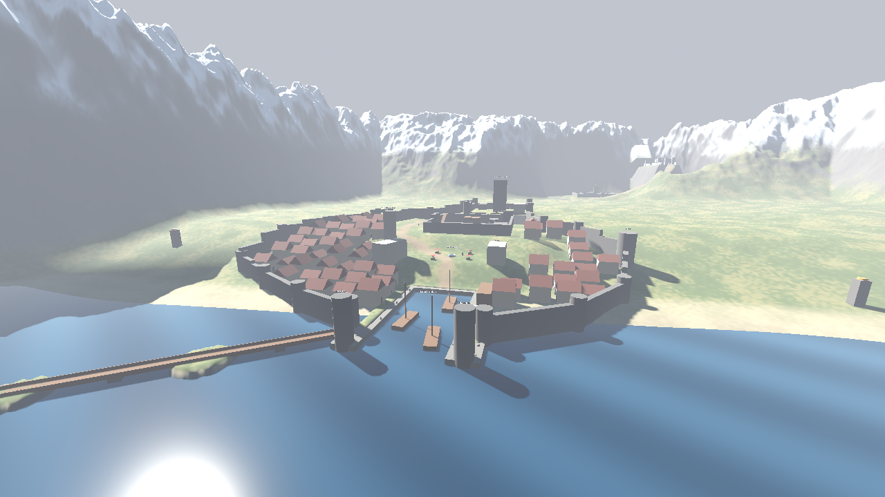 | 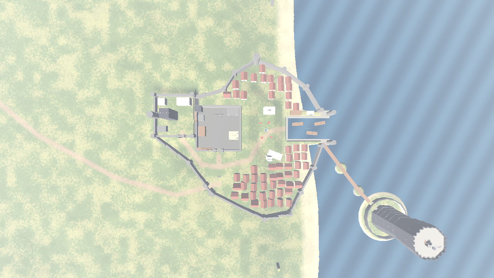 |

### Innenräume: Schwarzer Bergfried und Gravecrest

Gebaut nach deinen Grundrissen und Schnitten.

**Schwarzer Bergfried:** achteckiger Turm, 40 m breit. Die Mauern sind unten 10 m dick, im Schaft 5 m und an der Krone 3 m. Der Turm verjüngt sich nach oben und wird an der Krone wieder breiter. Alle 13 Ebenen sind begehbar, über eine **Wendelrampe um die Mittelsäule** im zentralen Treppenhaus:

| Ebene | Raum | Ebene | Raum |
|---|---|---|---|
| −4 | Sonderzellen | 3 | Ausbildung |
| −3 | Zellentrakt | 4 | **Archive** mit dem **Namensbuch** und **Hüterin der Stille Leofa Marsh** |
| −2 | Zisternen | 5 | **Stillebene**, vollständig leer |
| −1 | Interne Sicherung | 6 | Thronsaal, bewusst schlicht |
| 0 | Schwelle (Eingang von der Brücke) | 7 | Vorbereitung |
| 1 | Wachring | 8 | Observatorium |
| 2 | Unterkünfte | Dach | Zinnen und das **Feuerbecken des ersten Feuers** |

Der Unterbau liegt unter dem Meeresspiegel. Das Tor öffnet der Bergwächter erst nach dem Haupteid, dann darfst du deinen Namen im Namensbuch suchen.

**Gravecrest:** nach dem Grundriss, alle nummerierten Räume begehbar:
- **Palas-Block** mit Kaisersaal, Imperialen Gemächern, Audienzsaal, Bibliothek, Schreibstube, Garderobe, Speisesaal und der Kapelle des Sorrow, verbunden über eine Halle.
- **Oberer und Unterer Hof** mit Schmieden, Apotheken, Wachräumen, Kaserne, Akademie, Badehaus, Speichern, Ställen und Brunnenhäusern.
- Der **achteckige Donjon** trennt die Höfe. Man geht durch ihn hindurch und kann über die Wendelrampe zur Signalfeuerplattform steigen.
- **Torhaus** mit Fallgatter und Zugbrücke über den Abgrund, Flaschenzug an der Westseite.
- Im Audienzsaal sitzt **Komtur Torben Wick**.
- Das Fallgatter zieht der Kammbrecher an der Brücke erst für Wächter hoch.

| Wendelrampe im Bergfried | Archive mit Namensbuch |
|---|---|
| 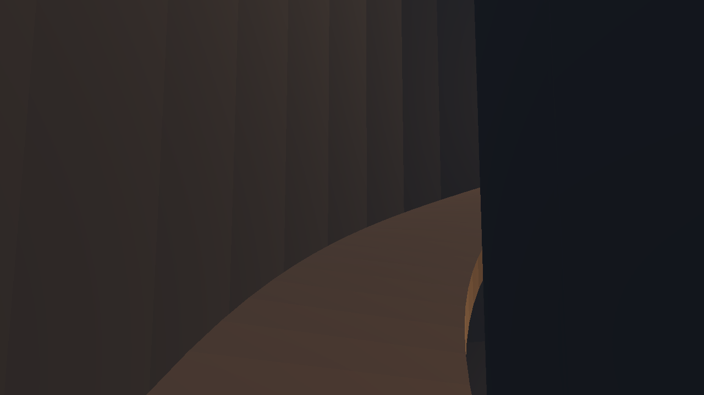 | 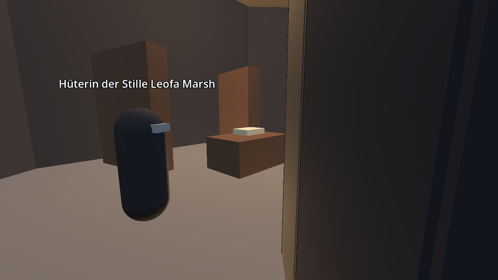 |
| **Der Schwarze Bergfried** | **Gravecrest von oben** |
| 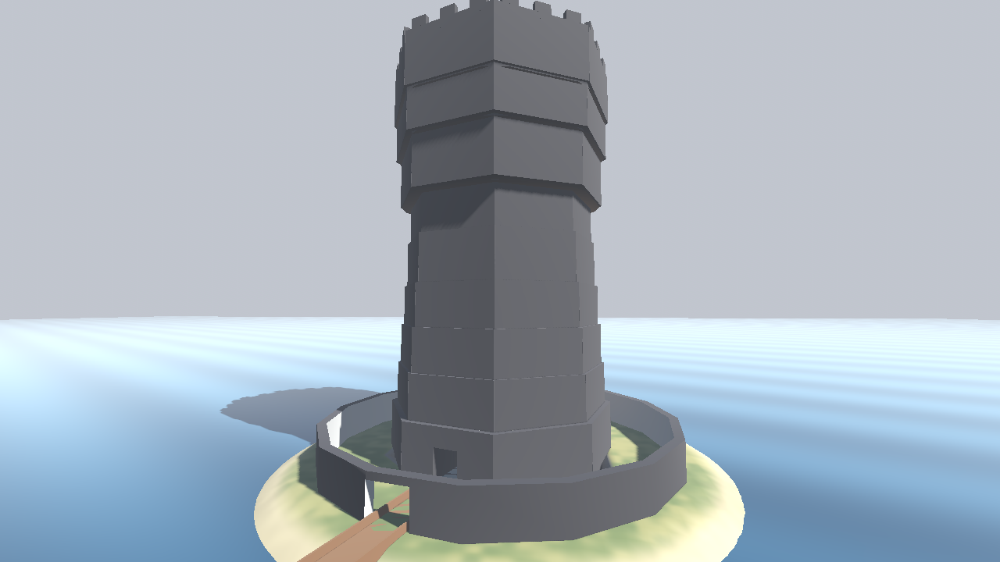 | 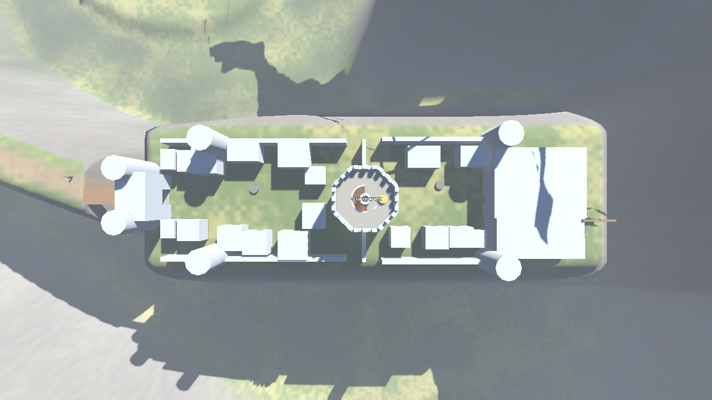 |

### Die Region Drachenstein

Die erste begehbare Region, gebaut nach deiner Karte im Maßstab **1:50** (1 km = 20 m). Gebäude sind noch Platzhalter aus einfachen Formen.

| Ort | Was dort steht |
|---|---|
| **Burgfeste Drachenstein** | nach Grundriss (siehe oben): Hof, Oberer Burg, Stadt mit Markt, Kirche und Rathaus, Ringmauer mit Vorburgtor und Ölturm |
| **Drachenkai** | Hafenbecken im Osten, Molen mit Hafentor und Schiffstor, Zollhaus, Schiffe, Lotsin aus Riverlock |
| **Brücken zum Bergfried** | drei Brücken von der Südmole über zwei Inseln |
| **Schwarzer Bergfried** | 100 m hoher achteckiger Turm mit Krone und äußerer Mauer, Bergwächter am Tor |
| **Gravemarch** | nach Grundriss (siehe oben): Talburg im Sumpf mit Wassergraben, drei Ringen, Scheintoren und begehbarem Donjon |
| **Gravecrest** | auf dem eisigen Felssporn (Höhe 70), Weg hinauf, Zugbrücke über den Abgrund, Torhaus, achteckiger Donjon, Palas |
| **Eisgrat** | Gebirge ringsum, Signaltürme an der Küste |

Dazu kommen:
- **Ortsnamen**, die beim Betreten groß eingeblendet werden.
- **Karte auf M** (deine Sorrowland-Karte, mit Pfeil für Position und Blickrichtung).
- **Schutz vor Meer und Rand:** Wer ins Wächtermeer fällt oder über den Rand will, wird zurückgesetzt.
- Fünf neue Personen in der Region.

| Drachenstein und Hafen | Gravecrest auf dem Felssporn |
|---|---|
|  | 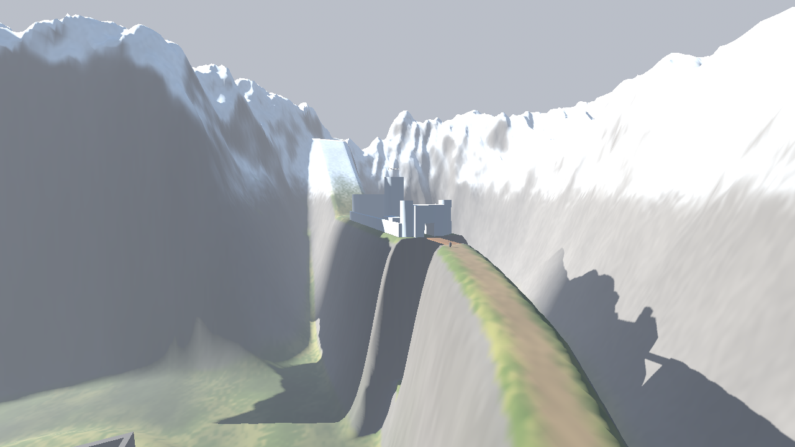 |
| **Brücken zum Schwarzen Bergfried** | **Karte (M)** |
| 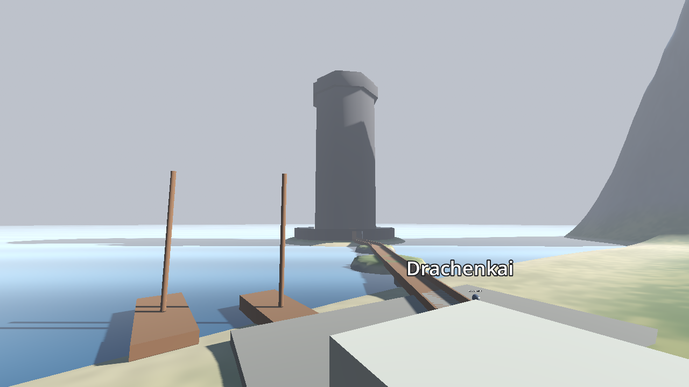 | 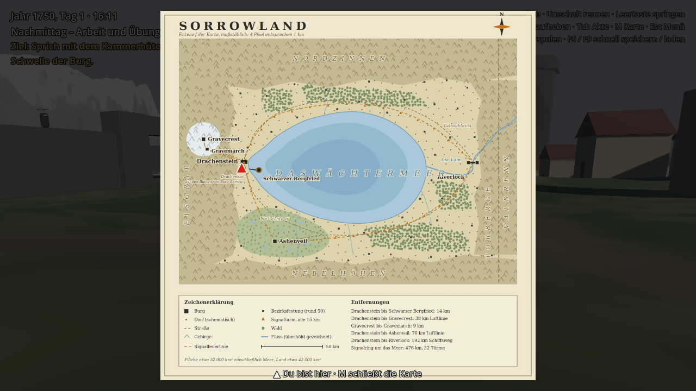 |

### Akt I – „Die Schwelle“ ist durchspielbar

Akt I spielt im Hof der Burgfeste Drachenstein und führt in etwa drei Spieljahren (1750 bis 1753) vom Bewerber bis zum Haupteid:

| Rang | Was du tust | Bei wem |
|---|---|---|
| Bewerber → **Anwärter** | Vorgespräch und Gelöbnis an der Schwelle | Kammerhüter Wendel Groth (am Tor) |
| Anwärter | Bruchsteine aus dem Bauhof, Küchendienst beim Mittagsmahl (12–13 Uhr) | Hüterin Maren Sell, Verwalterin Ilse Dorn |
| | *Das Probejahr vergeht* | |
| Knappenprüfung | **Lesen:** drei Fragen zur Ordensregel | Schreiber Odo Hesse (Schreibstube) |
| | **Handwerk:** Eckstein an der Werkbank behauen (tagsüber) | Werkmeisterin Hedda Brunn (Bauhof) |
| | **Nachtwache** neben einem Hüter bis zum Morgengrauen | Hüter Anselm Kray (Wehrgang) |
| → **Knappe** | Eid des Knappen, *zwei Lehrjahre vergehen* | Maren Sell |
| | **Torwache**, zwei Stunden, bis die Ablösung kommt | Wachführer Ivo Grend (Tor) |
| → **Geselle** | Eid des Gesellen | Maren Sell |
| | **Fenn** wirbt für die Rufer: melden, schweigen oder die Nebenpforte öffnen | Fenn, Kammerhüter |
| | **Nachtwache allein auf dem Turm**, Zustimmung von Hüterin und Wachführer | Wachturm, Maren Sell, Ivo Grend |
| → **Wächter** | Haupteid, dein Name kommt als Stein in die Ordenswand | Komtur Aldric Hayn (Ordenswand) |

Dazu kommen diese Systeme:

- **Tageszyklus** nach dem Alltag des Ordens mit Mondlicht in der Nacht. Um 19 Uhr beginnt die **Stille-Stunde**: Wer dann spricht, wird ermahnt und bekommt danach einen Verweis.
- **Dienstakte** (Tab) mit Rang, Kordel, Bürge und allen Einträgen. Verweise färben sie rot, und bei Beförderungen zögert dann die Versammlung.
- **Wachposten:** Wer einen Posten vor der Ablösung verlässt, bekommt einen Verweis („Nicht früher, nicht später.“).
- **Ziel-Anzeige** oben links, damit du immer weißt, was als Nächstes kommt.
- **Kordel am Kragen** der Spielfigur je nach Rang: keine, schwarz, grau oder golden.
- **Drei Ausgänge für Fenn:** Wer meldet, bleibt sauber. Wer schweigt, bekommt einen Verweis, und der Bürge wird mitverhandelt. Wer die Pforte öffnet, wird verbannt, und das Spiel endet.
- **Speichern und Laden** (siehe unten).

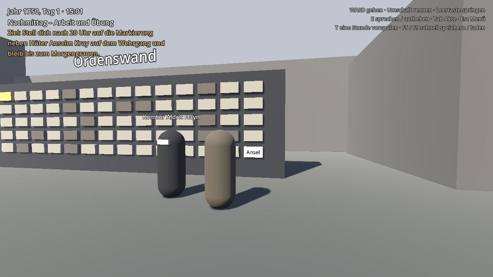

## Starten

1. **Godot 4.7** (oder neuer) herunterladen: <https://godotengine.org/download>
   Die **Standardversion** nehmen, nicht die .NET-Version. Godot muss nicht installiert werden, die Datei einfach entpacken und starten.
2. Im Projektmanager auf **Importieren** klicken und die Datei `project.godot` aus diesem Ordner wählen.
3. Im Editor oben rechts auf **▶ (Projekt starten)** klicken oder **F5** drücken. Das Spiel beginnt im Hauptmenü.

## Steuerung

| Taste | Aktion |
|---|---|
| W A S D | gehen |
| Umschalt | rennen |
| Leertaste | springen |
| Maus | Kamera |
| E | sprechen, aufheben, arbeiten, im Gespräch weiter |
| 1–9 | Antwort wählen (oder mit der Maus klicken) |
| Tab | Dienstakte ein/aus |
| M | Karte ein/aus |
| T | eine Stunde vorspulen (praktisch für Nachtwachen) |
| Esc | Pausemenü: Speichern, Laden, Hauptmenü |
| F5 / F9 | schnell speichern / schnell laden (im laufenden Spiel) |
| F10 | Entwicklermenü (nur beim Start aus dem Editor): zu Orten springen, Uhrzeit, alle Tore öffnen, Akt I überspringen |

Den Wehrgang erreichst du über die Holzrampe an der Südmauer, westlich vom Tor. Von dort führt die Westmauer zur zweiten Rampe hinauf auf den Wachturm in der Nordwestecke.

Wege durch die Region: Vom Tor des Hofs führt der Weg nach Osten über den Marktplatz zum Drachenkai und von der Südmole über die Brücken zum Bergfried. Ein zweiter Weg steigt nach Westen zum Tor der Oberer Burg. Der Weg nach Westen führt aus dem Vorburgtor ins Tal bis zur Brückenpforte von Gravemarch. Kurz vor Gravemarch zweigt der Weg nach Norden ab und steigt auf den Felssporn nach Gravecrest.

## Speichern und Laden

- **Hauptmenü:** Fortsetzen (neuester Spielstand), Neues Spiel (mit deinem Namen), Laden, Beenden.
- **Pausemenü (Esc):** drei Speicherplätze, Laden aus allen Plätzen.
- **Automatisch** wird nach jedem Rangwechsel und jedem Zeitsprung gespeichert.
- **Schnellspeichern** mit F5, schnell laden mit F9.
- Gespeichert werden Name, Rang, Akte, Flags, Zähler, Ziel, Uhrzeit und Jahr, Position und Blickrichtung sowie aufgehobene Gegenstände.
- Die Dateien liegen als lesbares JSON im Godot-Benutzerordner unter `speicher/`. Unter Windows ist das `%APPDATA%\Godot\app_userdata\Sorrowland_ In Silentio\speicher\`. In Godot öffnest du den Ordner über **Projekt → Benutzerdatenordner öffnen**.

## Projektaufbau

```
project.godot              Projekteinstellungen, Tastenbelegung, Autoloads
autoload/                  immer geladene Spielsysteme
  spielzeit.gd             Uhrzeit, Jahr, Tagesabschnitte, Stille-Stunde, Zeitsprünge
  spielstand.gd            Name, Rang, Akte, Verweise, Flags, Zähler, Ziel, Bedingungen
  dialog.gd                liest und führt die Gespräche aus daten/dialoge/
  speicher.gd              Speichern, Laden, neues Spiel, Szenenwechsel
szenen/
  oberflaeche/hauptmenue.tscn  Startszene
  oberflaeche/pausemenue.tscn  Esc-Menü
  oberflaeche/hud.tscn     Uhr, Ziel, Hinweise, Gesprächsfenster, Akte, Blenden
  welt/region_drachenstein.tscn  die Region: Gelände, Meer, Burgen, Brücken, Orte, Personen
  welt/burg_hof.tscn       der Hof aus Akt I mit seinen Personen und Posten
  welt/gelaende.gd         baut Gelände und Kollision aus daten/gelaende/
  welt/gelaende.gdshader   Farben des Geländes: Strand, Gras, Fels, Schnee, Wege, Sumpf
  welt/wasser.gdshader     das Wächtermeer
  welt/auf_gelaende.gd     setzt Häuser und Personen auf die Geländehöhe
  welt/ort.gd              benannter Ort, zeigt beim Betreten den Namen
  welt/haus.tscn           Stadthaus
  welt/turm.gd             begehbarer achteckiger Turm: Ebenen, Wendelrampe, Türen, Zinnen
  welt/tor.gd              Tor, das sich erst unter einer Bedingung öffnet
  welt/lesbar.gd           Gegenstand zum Lesen oder Ansehen (Namensbuch, Feuerbecken)
  oberflaeche/entwickler.tscn  Entwicklermenü (F10)
  welt/tageslicht.gd       Sonne, Mond, Himmel und Nebel nach Uhrzeit
  welt/ordenswand.gd       Namenssteine, nach dem Haupteid auch deiner
  welt/posten.gd           Wachposten (Torwache, Nachtwachen)
  spieler/                 Spielfigur und Kamera
  figuren/person.tscn      ansprechbare Person
  figuren/bruchstein.tscn  Gegenstand zum Aufheben
  figuren/werkbank.tscn    Arbeitsstelle (kostet Spielzeit)
daten/dialoge/             Gespräche als JSON-Dateien
daten/gelaende/            Höhen (hoehen.r32), Wege und Sumpf (maske.png), Vorschau
daten/karten/              die Karte von Sorrowland für die Taste M
werkzeuge/                 Gelände-Generator (in Godot ausführbar)
tests/                     automatische Tests
docs/                      Lore-Bibel, Spielkonzept, Karten, Bilder (von Godot ignoriert)
```

## Eine neue Person hinzufügen

1. `szenen/welt/region_drachenstein.tscn` öffnen (für den Hof: `szenen/welt/burg_hof.tscn`).
2. `szenen/figuren/person.tscn` aus dem Dateisystem-Dock in die Szene ziehen. In der Region unter **Personen/PersonenAmBoden** setzt sie sich von selbst auf die Geländehöhe.
3. Im Inspektor ausfüllen:
   - **Anzeige Name**
   - **Dialog Id** (Dateiname ohne `.json`)
   - **Kordel** (Rang)
   - **Tracht** (Farbe)
   - optional **Sichtbar Wenn**, eine Bedingung, solange die Person da ist
4. Eine Datei `daten/dialoge/<dialog_id>.json` anlegen (siehe unten).

## Das Gelände verändern

Das Gelände wird aus `werkzeuge/gelaende_erzeuger.gd` erzeugt. Dort stehen die Lage der Orte, die Wege, das Gebirge, der Felssporn, die Küste und die Inseln, jeweils mit Kommentar.

1. Werte im Erzeuger ändern, z. B. einen Weg oder die Höhe des Felssporns.
2. `werkzeuge/gelaende_erzeugen.gd` öffnen und **Datei → Ausführen** wählen (Strg+Umschalt+X).
3. Die Szene `region_drachenstein.tscn` neu öffnen.

`daten/gelaende/vorschau.png` zeigt das Ergebnis von oben. Signaltürme und Personen unter einem Knoten mit `auf_gelaende.gd` (Signaltuerme, PersonenAmBoden) folgen der neuen Geländehöhe von selbst. Die Bauten von Drachenstein (Ringmauer, Stadthäuser, Kirche) haben feste Höhen, die beim Bau der Szene aus dem Gelände gelesen wurden. Wer das Gelände um Drachenstein ändert, verschiebt sie im Editor mit oder sagt mir Bescheid, dann baue ich die Szene neu.

## Einen Turm bauen

`szenen/welt/turm.gd` baut aus einer Liste von Ebenen einen begehbaren achteckigen Turm, auch im Editor. Im Inspektor einstellen:

| Wert | Bedeutung |
|---|---|
| Ebenen Nummern / Namen | z. B. −4 bis 8, „Archive“, „Stillebene“ |
| Boden Hoehen | Höhe jedes Bodens, ein Eintrag mehr als Ebenen (der letzte ist das Dach) |
| Aussen Radien / Wandstaerken | je Ebene, so entstehen Verjüngung und Krone |
| Eingaenge | Türen in der Außenmauer: (Ebene, Winkel) |
| Treppen Winkel | Richtung der Türen zum Treppenhaus |
| Wasserdicht | Turm reicht unter den Meeresspiegel (keine Rettung aus dem Wasser innen) |

Jede Ebene bekommt automatisch Licht und ein Schild „Ebene X · Name“. Vorlagen sind der Bergfried und der Donjon von Gravecrest. Die Rampe bleibt flacher als 35°, wenn die Mittelsäule dick genug ist (Bergfried 1,9 m, Donjon 1,4 m).

## Einen Wachposten hinzufügen

Einen `Area3D`-Knoten mit dem Skript `szenen/welt/posten.gd` und einer `CollisionShape3D` anlegen. Im Inspektor einstellen:
- **Bedingung:** wann der Posten zählt
- **Erledigt Flag:** welches Flag am Ende gesetzt wird
- **Dauer Minuten** oder **Bis Abschnitt** (z. B. `morgengrauen`)
- die Texte für Beginn, Mitte und Ende

Vorlagen sind die drei Posten unter **Posten** im Hof.

## Dialoge schreiben

Jede Datei hat Knoten. Begonnen wird beim Knoten `start`, außer ein Eintrag in `einstieg` passt. Diese werden von oben nach unten geprüft, der erste passende gewinnt. Deshalb gehören die späten Spielabschnitte nach oben.

```json
{
	"einstieg": [
		{ "bedingung": "geloebnis", "knoten": "danach" }
	],
	"knoten": {
		"start": {
			"text": "Was die Person sagt. {name} wird durch den Namen des Spielers ersetzt.",
			"optionen": [
				{ "text": "Antwort 1", "weiter": "zweiter_knoten" },
				{ "text": "Antwort 2", "bedingung": "fenn_fragte,!fenn_gemeldet", "setze": ["neues_flag"] }
			]
		},
		"zweiter_knoten": {
			"text": "Ohne Antworten geht es mit E weiter oder das Gespräch endet.",
			"ziel": "Neues Ziel für die Anzeige oben links.",
			"weiter": "danach"
		},
		"danach": { "text": "Wach gut." }
	}
}
```

**Felder in Knoten und Antworten:**

| Feld | Wirkung |
|---|---|
| `text` | gesprochener Text. `{name}` und `{buerge}` werden ersetzt |
| `sprecher` | anderer Sprechername als die Person (nur Knoten) |
| `weiter` | nächster Knoten. Fehlt er, endet das Gespräch |
| `bedingung` | nur bei Antworten und Einstiegen: wann sie sichtbar oder gültig sind |
| `setze` | Liste von Flags, die gesetzt werden |
| `akte` | Eintrag in die Dienstakte |
| `verweis` | Verweis (Stufe 1) in die Akte, zählt `verweise` hoch |
| `zaehler` | Zähler ändern, z. B. `{ "bruchsteine": -3 }` |
| `rang` | Rang setzen (0 Bewerber, 1 Anwärter, 2 Knappe, 3 Geselle, 4 Wächter …) |
| `ziel` | neues Ziel oben links |
| `meldung` | kurze Einblendung oben im Bild |
| `zeitsprung` | `{ "jahre": 2, "text": "Zwei Jahre vergehen." }` mit schwarzer Blende |
| `blende` | schwarze Blende mit Text, danach geht es weiter |
| `akt_ende` | lange Blende zum Ende eines Akts |
| `spielende` | Blende, danach zurück ins Hauptmenü |

**Bedingungen:** `flag` (gesetzt), `!flag` (nicht gesetzt), `zaehler>=3`, `rang>=2`, `abschnitt=mittag` (morgengrauen, vormittag, mittag, nachmittag, stille_stunde, nacht). Mehrere werden durch Komma getrennt und müssen alle gelten.

## Testen

Vier automatische Tests, alle mit eigenem Speicherordner, sodass deine Spielstände unberührt bleiben:

| Test | Prüft |
|---|---|
| `tests/test_akt1.gd` | Akt I komplett, 42 Punkte: falsche Antworten, zu früh verlassener Posten, Speichern und Laden, alle drei Ausgänge des Fenn-Strangs |
| `tests/test_eingabe.gd` | echte Tastendrücke: E zum Ansprechen und Aufheben, Zifferntasten im Gespräch |
| `tests/test_innen.gd` | die Innenräume, 25 Punkte, mit echtem Gehen: Bergfried-Tor zu und auf, Wendelrampe hinauf aufs Dach und hinunter bis Ebene −4, Namensbuch, Hüterin, Feuerbecken, Fallgatter, Torhaus, durch den Donjon und hinauf, Torben Wick, Entwicklermenü, in Gravemarch Donjon, Archivarin und Scheintore |
| `tests/test_region.gd` | die Region, 30 Punkte: Gelände, Gehen durch das Tor und über Rampen und Brücken, die Wege zur Oberer Burg, zum Kai und durchs Vorburgtor, durch das Labyrinth von Gravemarch, Ortsnamen, Meer und Rand, alle fünf neuen Personen, Karte, Speichern und Laden, Umzug alter Spielstände |

```
godot --headless --path . --script res://tests/test_akt1.gd
godot --headless --path . --script res://tests/test_eingabe.gd
godot --headless --path . --script res://tests/test_region.gd
godot --headless --path . --script res://tests/test_innen.gd
```

Am Ende steht jeweils `Fehler: 0`, wenn alles stimmt.

## Nächste Schritte

Siehe Fahrplan in [`docs/02-spielkonzept.md`](docs/02-spielkonzept.md), Abschnitt 8. Offen in Stufe 3 sind Riverlock und Ashenveil (die Grundrisse liegen vor, sie brauchen aber eigene Regionen) sowie echte Modelle statt Klötzen. Danach folgen die Systeme aus Stufe 4: Kampf, Ansehen, Alarmstufen.
