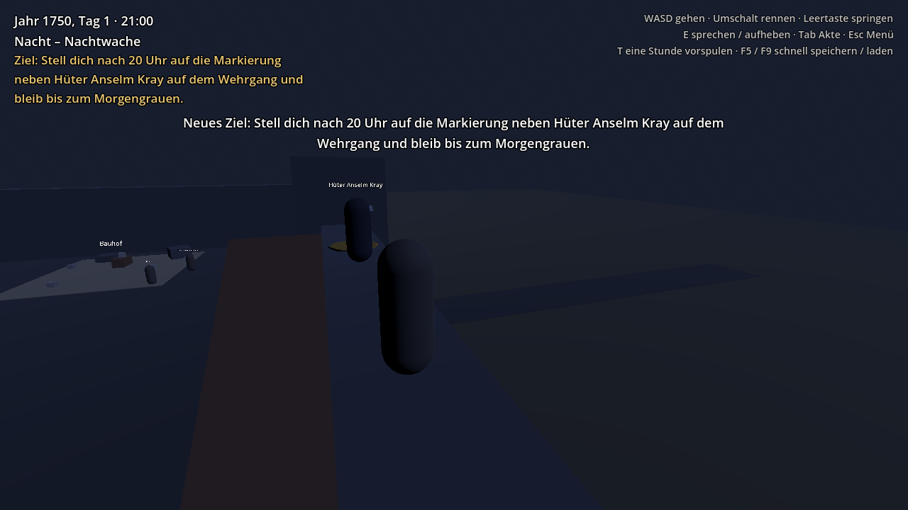

# Sorrowland: In Silentio

> *In silentio vigilamus. Aber wenn die Stille endet, handeln wir.*

Ein Open-World-Rollenspiel im Sorrowland des Jahres 1750: Du trittst als Vertriebener an die Schwelle des Ordo Custodum und steigst vom Anwärter zum Wächter auf, während die 620 Jahre alte Stille zu zerbrechen droht.

- Lore: [`docs/01-lore-bibel.md`](docs/01-lore-bibel.md)
- Spielkonzept und Fahrplan: [`docs/02-spielkonzept.md`](docs/02-spielkonzept.md)
- Karten: [`docs/bilder/`](docs/bilder/)



## Stand: Akt I – „Die Schwelle“ ist durchspielbar

Der Hof der Burgfeste Drachenstein als Graybox (Platzhalter aus einfachen Formen). Akt I führt in etwa drei Spieljahren (1750 bis 1753) vom Bewerber bis zum Haupteid:

| Rang | Was du tust | Bei wem |
|---|---|---|
| Bewerber → **Anwärter** | Vorgespräch und Gelöbnis an der Schwelle | Kammerhüter Wendel Groth (am Tor) |
| Anwärter | Bruchsteine aus dem Bauhof, Küchendienst beim Mittagsmahl (12–13 Uhr) | Hüterin Maren Sell, Verwalterin Ilse Dorn |
| | *Das Probejahr vergeht* | |
| Knappenprüfung | **Lesen:** drei Fragen zur Ordensregel | Schreiber Odo Hesse (Schreibstube) |
| | **Handwerk:** Eckstein an der Werkbank behauen (tagsüber) | Werkmeisterin Hedda Brunn (Bauhof) |
| | **Nachtwache** neben einem Hüter bis zum Morgengrauen | Hüter Anselm Kray (Wehrgang) |
| → **Knappe** | Eid des Knappen, *zwei Lehrjahre vergehen* | Maren Sell |
| | **Torwache**, zwei Stunden, bis die Ablösung kommt | Wachführer Ivo Grend (Tor) |
| → **Geselle** | Eid des Gesellen | Maren Sell |
| | **Fenn** wirbt für die Rufer: melden, schweigen oder die Nebenpforte öffnen | Fenn, Kammerhüter |
| | **Nachtwache allein auf dem Turm**, Zustimmung von Hüterin und Wachführer | Wachturm, Maren Sell, Ivo Grend |
| → **Wächter** | Haupteid, dein Name kommt als Stein in die Ordenswand | Komtur Aldric Hayn (Ordenswand) |

Dazu kommen diese Systeme:

- **Tageszyklus** nach dem Alltag des Ordens mit Mondlicht in der Nacht. Um 19 Uhr beginnt die **Stille-Stunde**: Wer dann spricht, wird ermahnt und bekommt danach einen Verweis.
- **Dienstakte** (Tab) mit Rang, Kordel, Bürge und allen Einträgen. Verweise färben sie rot, und bei Beförderungen zögert dann die Versammlung.
- **Wachposten:** Wer einen Posten vor der Ablösung verlässt, bekommt einen Verweis („Nicht früher, nicht später.“).
- **Ziel-Anzeige** oben links, damit du immer weißt, was als Nächstes kommt.
- **Kordel am Kragen** der Spielfigur je nach Rang: keine, schwarz, grau oder golden.
- **Drei Ausgänge für Fenn:** Wer meldet, bleibt sauber. Wer schweigt, bekommt einen Verweis, und der Bürge wird mitverhandelt. Wer die Pforte öffnet, wird verbannt, und das Spiel endet.
- **Speichern und Laden** (siehe unten).


## Starten

1. **Godot 4.7** (oder neuer) herunterladen: <https://godotengine.org/download>
   Die **Standardversion** nehmen, nicht die .NET-Version. Godot muss nicht installiert werden, die Datei einfach entpacken und starten.
2. Im Projektmanager auf **Importieren** klicken und die Datei `project.godot` aus diesem Ordner wählen.
3. Im Editor oben rechts auf **▶ (Projekt starten)** klicken oder **F5** drücken. Das Spiel beginnt im Hauptmenü.

## Steuerung

| Taste | Aktion |
|---|---|
| W A S D | gehen |
| Umschalt | rennen |
| Leertaste | springen |
| Maus | Kamera |
| E | sprechen, aufheben, arbeiten, im Gespräch weiter |
| 1–9 | Antwort wählen (oder mit der Maus klicken) |
| Tab | Dienstakte ein/aus |
| T | eine Stunde vorspulen (praktisch für Nachtwachen) |
| Esc | Pausemenü: Speichern, Laden, Hauptmenü |
| F5 / F9 | schnell speichern / schnell laden (im laufenden Spiel) |

Den Wehrgang erreichst du über die Holzrampe an der Südmauer, westlich vom Tor. Von dort führt die Westmauer zur zweiten Rampe hinauf auf den Wachturm in der Nordwestecke.

## Speichern und Laden

- **Hauptmenü:** Fortsetzen (neuester Spielstand), Neues Spiel (mit deinem Namen), Laden, Beenden.
- **Pausemenü (Esc):** drei Speicherplätze, Laden aus allen Plätzen.
- **Automatisch** wird nach jedem Rangwechsel und jedem Zeitsprung gespeichert.
- **Schnellspeichern** mit F5, schnell laden mit F9.
- Gespeichert werden Name, Rang, Akte, Flags, Zähler, Ziel, Uhrzeit und Jahr, Position und Blickrichtung sowie aufgehobene Gegenstände.
- Die Dateien liegen als lesbares JSON im Godot-Benutzerordner unter `speicher/`. Unter Windows ist das `%APPDATA%\Godot\app_userdata\Sorrowland_ In Silentio\speicher\`. In Godot öffnest du den Ordner über **Projekt → Benutzerdatenordner öffnen**.

## Projektaufbau

```
project.godot              Projekteinstellungen, Tastenbelegung, Autoloads
autoload/                  immer geladene Spielsysteme
  spielzeit.gd             Uhrzeit, Jahr, Tagesabschnitte, Stille-Stunde, Zeitsprünge
  spielstand.gd            Name, Rang, Akte, Verweise, Flags, Zähler, Ziel, Bedingungen
  dialog.gd                liest und führt die Gespräche aus daten/dialoge/
  speicher.gd              Speichern, Laden, neues Spiel, Szenenwechsel
szenen/
  oberflaeche/hauptmenue.tscn  Startszene
  oberflaeche/pausemenue.tscn  Esc-Menü
  oberflaeche/hud.tscn     Uhr, Ziel, Hinweise, Gesprächsfenster, Akte, Blenden
  welt/hof.tscn            der Hof mit allen Personen und Posten
  welt/tageslicht.gd       Sonne, Mond, Himmel und Nebel nach Uhrzeit
  welt/ordenswand.gd       Namenssteine, nach dem Haupteid auch deiner
  welt/posten.gd           Wachposten (Torwache, Nachtwachen)
  spieler/                 Spielfigur und Kamera
  figuren/person.tscn      ansprechbare Person
  figuren/bruchstein.tscn  Gegenstand zum Aufheben
  figuren/werkbank.tscn    Arbeitsstelle (kostet Spielzeit)
daten/dialoge/             Gespräche als JSON-Dateien
tests/test_akt1.gd         spielt Akt I automatisch durch
docs/                      Lore-Bibel, Spielkonzept, Karten, Bilder (von Godot ignoriert)
```

## Eine neue Person hinzufügen

1. `szenen/welt/hof.tscn` öffnen.
2. `szenen/figuren/person.tscn` aus dem Dateisystem-Dock in die Szene unter **Personen** ziehen.
3. Im Inspektor ausfüllen:
   - **Anzeige Name**
   - **Dialog Id** (Dateiname ohne `.json`)
   - **Kordel** (Rang)
   - **Tracht** (Farbe)
   - optional **Sichtbar Wenn**, eine Bedingung, solange die Person da ist
4. Eine Datei `daten/dialoge/<dialog_id>.json` anlegen (siehe unten).

## Einen Wachposten hinzufügen

Einen `Area3D`-Knoten mit dem Skript `szenen/welt/posten.gd` und einer `CollisionShape3D` anlegen. Im Inspektor einstellen:
- **Bedingung:** wann der Posten zählt
- **Erledigt Flag:** welches Flag am Ende gesetzt wird
- **Dauer Minuten** oder **Bis Abschnitt** (z. B. `morgengrauen`)
- die Texte für Beginn, Mitte und Ende

Vorlagen sind die drei Posten unter **Posten** im Hof.

## Dialoge schreiben

Jede Datei hat Knoten. Begonnen wird beim Knoten `start`, außer ein Eintrag in `einstieg` passt. Diese werden von oben nach unten geprüft, der erste passende gewinnt. Deshalb gehören die späten Spielabschnitte nach oben.

```json
{
	"einstieg": [
		{ "bedingung": "geloebnis", "knoten": "danach" }
	],
	"knoten": {
		"start": {
			"text": "Was die Person sagt. {name} wird durch den Namen des Spielers ersetzt.",
			"optionen": [
				{ "text": "Antwort 1", "weiter": "zweiter_knoten" },
				{ "text": "Antwort 2", "bedingung": "fenn_fragte,!fenn_gemeldet", "setze": ["neues_flag"] }
			]
		},
		"zweiter_knoten": {
			"text": "Ohne Antworten geht es mit E weiter oder das Gespräch endet.",
			"ziel": "Neues Ziel für die Anzeige oben links.",
			"weiter": "danach"
		},
		"danach": { "text": "Wach gut." }
	}
}
```

**Felder in Knoten und Antworten:**

| Feld | Wirkung |
|---|---|
| `text` | gesprochener Text. `{name}` und `{buerge}` werden ersetzt |
| `sprecher` | anderer Sprechername als die Person (nur Knoten) |
| `weiter` | nächster Knoten. Fehlt er, endet das Gespräch |
| `bedingung` | nur bei Antworten und Einstiegen: wann sie sichtbar oder gültig sind |
| `setze` | Liste von Flags, die gesetzt werden |
| `akte` | Eintrag in die Dienstakte |
| `verweis` | Verweis (Stufe 1) in die Akte, zählt `verweise` hoch |
| `zaehler` | Zähler ändern, z. B. `{ "bruchsteine": -3 }` |
| `rang` | Rang setzen (0 Bewerber, 1 Anwärter, 2 Knappe, 3 Geselle, 4 Wächter …) |
| `ziel` | neues Ziel oben links |
| `meldung` | kurze Einblendung oben im Bild |
| `zeitsprung` | `{ "jahre": 2, "text": "Zwei Jahre vergehen." }` mit schwarzer Blende |
| `blende` | schwarze Blende mit Text, danach geht es weiter |
| `akt_ende` | lange Blende zum Ende eines Akts |
| `spielende` | Blende, danach zurück ins Hauptmenü |

**Bedingungen:** `flag` (gesetzt), `!flag` (nicht gesetzt), `zaehler>=3`, `rang>=2`, `abschnitt=mittag` (morgengrauen, vormittag, mittag, nachmittag, stille_stunde, nacht). Mehrere werden durch Komma getrennt und müssen alle gelten.

## Testen

`tests/test_akt1.gd` spielt Akt I komplett durch. Dabei prüft der Test 42 Punkte, unter anderem falsche Antworten, einen zu früh verlassenen Posten, Speichern und Laden sowie alle drei Ausgänge des Fenn-Strangs. Er benutzt einen eigenen Speicherordner, deine Spielstände bleiben unberührt.

```
godot --headless --path . --script res://tests/test_akt1.gd
```

Am Ende steht `Fehler: 0`, wenn alles stimmt.

## Nächste Schritte

Siehe Fahrplan in [`docs/02-spielkonzept.md`](docs/02-spielkonzept.md), Abschnitt 8. Als Nächstes käme die erste echte Region (Stufe 3): Drachenstein mit Brücken zum Schwarzen Bergfried und der Weg nach Gravecrest und Gravemarch, mit Gelände statt Klötzen.
